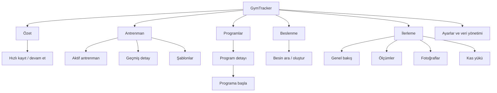
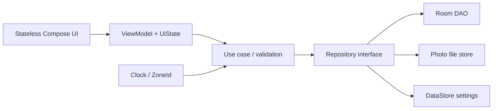

# GymTracker Ayrıntılı Geliştirme ve Modernizasyon Master Planı

> Tarih: 14 Temmuz 2026
> Dayanak: `PROJE_ANALIZ_RAPORU.md`
> Plan tipi: ürün + UX/UI + mimari + veri + kalite + yayın
> Varsayım: 1 deneyimli Android geliştirici, gerektiğinde yarı zamanlı tasarım/QA desteği

> Obsidian bilgi grafı ve oturum handoff sistemi: [`docs/obsidian/00_START_HERE.md`](docs/obsidian/00_START_HERE.md)

## 1. Planın amacı

Bu planın amacı mevcut GymTracker prototipini yeniden yazmadan; verisini koruyan, hızlı, modern, erişilebilir, test edilebilir ve mağaza yayınına hazırlanabilir bir Android ürününe dönüştürmektir.

Plan beş sonucu birlikte hedefler:

1. **Güvenilirlik:** Kullanıcı antrenmanı, ölçümü, beslenme kaydı ve fotoğrafı kaybolmamalı.
2. **Hızlı kullanım:** Spor salonunda set eklemek birkaç saniye sürmeli; temel aksiyonlar en fazla iki dokunuş uzakta olmalı.
3. **Modern görünüm:** Tutarlı Material 3 tabanlı tasarım sistemi, güçlü tipografi, sade veri görselleştirme ve akıcı hareket.
4. **Sürdürülebilir kod:** Reaktif state, repository sınırı, migration, test ve CI ile değişiklik riski azaltılmalı.
5. **Büyüme hazırlığı:** Program takibi, yedekleme, senkronizasyon ve gerçek premium gibi özellikler daha sonra eklenebilmeli.

Bu belge iş sırasını da belirler. Görsel yenileme, veri güvenliği çözülmeden bağımsız bir “makyaj projesi” olarak ele alınmayacaktır.

## 2. Ürün varsayımları ve karar verilmesi gereken konular

### Çalışma varsayımları

- Uygulama önce Android ve Türkçe için geliştirilecek.
- İlk stabil sürüm local-first ve hesap gerektirmeden çalışacak.
- Kilo birimi başlangıçta kilogram, ölçü birimi santimetre olacak; ayarlardan imperial birimler daha sonra eklenebilecek.
- Hazır program satın alma akışı beta aşamasında demo kalacak.
- “Kas yorgunluğu” tıbbi veya klinik bir ölçüm olarak sunulmayacak; “kas yükü” olarak yeniden konumlandırılacak.
- Minimum Android sürümü 26 şimdilik korunacak; değiştirmek ürün erişim verisi görüldükten sonra değerlendirilecek.

### Kodlamaya başlamadan önce ürün kararı gerekenler

| Karar | Önerilen başlangıç | Neden |
|---|---|---|
| Hesap zorunlu mu? | Hayır | İlk kullanım sürtünmesini ve backend kapsamını azaltır |
| Bulut senkronizasyonu | İlk beta sonrasına bırak | Önce yerel veri modelini stabilize etmek gerekir |
| Gerçek ödeme | İlk beta sonrasına bırak | Billing/backend ve hukuki kapsamı ayrı proje olmalı |
| Ana hedef kullanıcı | Düzenli ağırlık çalışan birey | Mevcut özelliklerle en uyumlu segment |
| Temel başarı aksiyonu | Antrenman başlatıp tamamlamak | Ürünün günlük çekirdek davranışı |
| Kas haritası adı | 7 Günlük Kas Yükü | Hesabın yaklaşık niteliğini doğru anlatır |
| Ana tema | Dark-first + tam light theme | Spor salonu kullanımına uygun, erişilebilir alternatif sunar |
| Navigasyon | 5 ana hedef | Mevcut 7 öğeli alt barı sadeleştirir |

Bu kararlar değişirse ilgili fazların kapsam ve tahmini yeniden düzenlenmelidir.

## 3. Ürün vizyonu ve tasarım ilkeleri

### Ürün vizyonu

GymTracker, kullanıcının antrenman sırasında hızlı kayıt yapabildiği; sonrasında performans, vücut, beslenme ve kas yükü gelişimini tek yerde anlamlandırabildiği kişisel fitness günlüğü olmalıdır.

### Deneyim ilkeleri

1. **Antrenman sırasında hız:** Görsel süsten önce tek elle kullanım ve düşük dokunma sayısı.
2. **Veri güven verir:** Otomatik kayıt, açık başarı/hata geri bildirimi ve veri kaybı olmaması.
3. **Özet önce, detay isteğe bağlı:** Dashboard hızlı okunmalı; ayrıntı drill-down ile açılmalı.
4. **Renk anlam taşır:** Ana marka rengi her yerde kullanılmamalı; başarı, uyarı, hata ve yük seviyeleri ayrı roller taşımalı.
5. **Kullanıcı kontrolü:** Silme geri alınabilir; yarım antrenman devam ettirilebilir; tarih ve birim değiştirilebilir.
6. **Sağlık iddiası sınırlı:** Tahmini metrikler açıkça açıklanmalı ve kesin sağlık tavsiyesi gibi sunulmamalı.
7. **Erişilebilirlik varsayılan:** Renk tek bilgi kanalı olmamalı; font büyütme ve TalkBack sonradan eklenen özellik olmamalı.
8. **Progressive disclosure:** Yeni kullanıcı sade deneyim görmeli, ileri seviye metrikler ihtiyaca göre açılmalı.

## 4. Bilgi mimarisi ve yeni navigasyon

### Telefon navigasyonu

Alt bar beş ana hedef içermeli:

1. **Özet** — günlük durum, haftalık görünüm, hızlı aksiyonlar
2. **Antrenman** — aktif antrenman, geçmiş, şablonlar
3. **Programlar** — hazır/kayıtlı programlar ve program takibi
4. **Beslenme** — gün seçimi, öğünler, kalori/makrolar
5. **İlerleme** — ölçümler, fotoğraflar, kas yükü ve grafikler

Ayarlar, profil/avatar veya sağ üst menüden açılmalıdır. Aktif antrenman ekranında alt navigasyon gizlenerek tam ekran, odaklı deneyim sunulmalıdır.

### Tablet ve büyük ekran

- Compact genişlik: bottom navigation
- Medium genişlik: navigation rail
- Expanded genişlik: kalıcı rail/drawer + liste/detay iki panel
- Program ve antrenman geçmişinde list-detail düzeni
- Fotoğraflarda üç veya dört kolonlu adaptif grid

### Hedef ekran haritası



### Route prensipleri

- Route’lar nesne değil yalnızca kararlı ID taşımalı.
- Liste ve detay gerçek navigation destination olmalı.
- ViewModel ID’yi `SavedStateHandle` üzerinden almalı.
- Sistem geri tuşu, deep link ve process recreation aynı davranışı üretmeli.
- Modal seçimler bottom sheet; bağımsız içerikler destination olmalı.
- Unsaved form kapatılırken yalnızca gerçek veri kaybı varsa onay istenmeli.

## 5. Görsel tasarım yönü

### Marka karakteri

Önerilen yön: **Kinetic Dark** — güçlü ama saldırgan olmayan; veri ağırlıklı, sıcak vurgu rengiyle enerjik, nötr yüzeylerle sakin bir performans ürünü.

Anahtar sıfatlar:

- Güçlü
- Net
- Hızlı
- Güvenilir
- Teknik ama soğuk olmayan
- Gösterişli değil, odaklı

### Renk sistemi

Mevcut kırmızı kimlik tamamen atılmamalı; ancak Material renk rollerine dönüştürülmelidir. Aşağıdaki değerler başlangıç token’larıdır; commit öncesi otomatik contrast testi zorunludur.

#### Dark theme başlangıç paleti

| Rol | Öneri | Kullanım |
|---|---|---|
| Background | `#0B0D10` | Ana zemin |
| Surface | `#14171C` | Kart ve sheet |
| Surface container | `#1B1F26` | Yükseltilmiş bileşen |
| Surface high | `#242A33` | Seçili/hover yüzey |
| Primary | `#FF6B5F` | Ana CTA, aktif durum |
| Primary container | `#5A201B` | Seçili kart/tonal CTA |
| Secondary | `#67C7F3` | Bilgi ve ikincil grafik |
| Tertiary | `#A3D65C` | İyi ilerleme/denge |
| Error | `#FF6B7A` | Hata ve tehlikeli aksiyon |
| Outline | `#343B46` | Ayırıcı ve input sınırı |
| On background | `#F3F5F7` | Ana metin |
| On surface variant | `#AAB1BC` | Yardımcı metin |

#### Light theme başlangıç paleti

| Rol | Öneri |
|---|---|
| Background | `#F7F8FA` |
| Surface | `#FFFFFF` |
| Surface container | `#EEF1F5` |
| Primary | `#B92D25` |
| Primary container | `#FFDAD5` |
| On background | `#17191D` |
| On surface variant | `#5D6470` |
| Outline | `#C7CDD6` |

#### Renk kullanım kuralları

- Primary yalnızca ana CTA, aktif nav ve önemli vurgu için kullanılmalı.
- Hata rengi primary’den görsel olarak ayrışmalı.
- Kas yükü haritası mavi→yeşil→sarı→turuncu→kırmızı ölçeğinin yanında metin/ikon/legend kullanmalı.
- Kırmızı ve yeşil tek başına başarı/hata bilgisini taşımamalı.
- Grafik serileri hem renk hem çizgi/nokta biçimiyle ayrıştırılmalı.
- Metin ve ikon kontrastı WCAG AA hedefini sağlamalı.

### Tipografi

İlk sürümde sistem fontu/Roboto kullanılabilir; marka ihtiyacı kesinleşirse Roboto Flex veya benzeri tek variable font değerlendirilebilir.

| Token | Boyut / ağırlık | Kullanım |
|---|---|---|
| Display small | 32sp / 700 | Önemli sayı ve başarı özeti |
| Headline medium | 28sp / 700 | Ana ekran başlığı |
| Headline small | 24sp / 700 | Detay başlığı |
| Title large | 20sp / 600 | Kart/section başlığı |
| Title medium | 16sp / 600 | Satır başlığı |
| Body large | 16sp / 400 | Ana içerik |
| Body medium | 14sp / 400 | Yardımcı içerik |
| Label large | 14sp / 600 | Buton |
| Label medium | 12sp / 600 | Chip ve metadata |

Sayı gösterimlerinde tabular numerals kullanılmalı. Kilo, tekrar, süre ve kalori değerleri aynı hizada okunabilmelidir. Satır yüksekliği metin boyutunun yaklaşık 1,35–1,5 katı tutulmalıdır.

### Ölçü, şekil ve katman token’ları

- Temel grid: 4 dp
- Ekran yatay padding: compact 16 dp, medium 24 dp, expanded 32 dp
- Section aralığı: 24–32 dp
- Kart iç padding: 16 dp
- Kart radius: 20 dp
- Input/button radius: 14–16 dp
- Bottom sheet üst radius: 28 dp
- Chip radius: tam yuvarlak veya 12 dp
- Minimum dokunma hedefi: 48×48 dp
- Ana buton yüksekliği: 52–56 dp
- İnce ayırıcı yerine çoğunlukla surface tonu ve spacing kullanılmalı
- Elevation yalnızca hiyerarşi için; sürekli gölge kullanımından kaçınılmalı

### İkonografi

- Tek bir ikon ailesi: Material Symbols Rounded veya mevcut Material ikonlarının tutarlı subset’i
- Standart boyut: 24 dp; küçük metadata ikonu: 16–18 dp
- Aktif/pasif ikonlarda filled/outlined eşleşmesi
- Sadece ikon içeren her aksiyonda erişilebilir ad
- Rastgele emoji veya farklı stroke kalınlığındaki ikonlar kullanılmamalı

### Hareket ve haptics

| Hareket | Süre | Kullanım |
|---|---:|---|
| Micro feedback | 100–150 ms | Buton/chip state |
| Standard transition | 200–250 ms | Kart açılma, sekme geçişi |
| Emphasized transition | 300–400 ms | Bottom sheet, başarı özeti |

- `reduce motion` tercihine saygı gösterilmeli.
- Set tamamlamada hafif haptic, antrenman bitirmede belirgin ama kısa haptic kullanılabilir.
- Sonsuz parlama yalnızca seçili kas gibi gerçekten odak gereken yerde ve düşük yoğunlukta olmalı.
- Sayı animasyonu state doğruluğunu geciktirmemeli.

## 6. Tasarım sistemi ve ortak bileşenler

### Temel altyapı

- `GymTrackerTheme`: light/dark/system seçenekleri
- Semantic color tokens
- Typography tokens
- Spacing/radius tokens
- Window size/adaptive layout yardımcıları
- Preview theme matrisi: light, dark, büyük font

### Ortak bileşen kataloğu

| Bileşen | Zorunlu durumlar |
|---|---|
| `GtTopAppBar` | normal, scroll-collapsed, geri butonlu |
| `GtPrimaryButton` | normal, disabled, loading |
| `GtTonalButton` | normal, disabled |
| `GtMetricCard` | değer, trend, boş, loading |
| `GtProgressCard` | normal, hedef aşımı, hata |
| `GtSectionHeader` | başlık, açıklama, “Tümünü gör” |
| `GtEmptyState` | ikon, başlık, açıklama, CTA |
| `GtErrorState` | retry, offline/izin özel hali |
| `GtNumberField` | suffix, locale decimal, hata |
| `GtNumberStepper` | tekrar/set/hızlı ağırlık değişimi |
| `GtDateHeader` | gün değiştir, bugün kısayolu |
| `GtExerciseRow` | normal, seçili, favori, disabled |
| `GtSetRow` | pending, completed, invalid, personal best |
| `GtChartCard` | empty, loading, selected point |
| `GtConfirmSheet` | tehlikeli işlem, normal onay |
| `GtSnackbarHost` | undo, success, error |

### Bileşen kalite kuralları

- Stateful route ve stateless content ayrılmalı.
- Her ortak bileşenin light/dark preview’ı olmalı.
- Her input’un label, supporting/error text ve erişilebilir semantics’i olmalı.
- Disabled state yalnızca alpha düşürmekle bırakılmamalı; kontrast korunmalı.
- Loading sırasında layout zıplamaması için skeleton boyutu gerçek içerikle aynı olmalı.
- Empty, loading ve error state ekran bazında sonradan eklenmemeli; tasarım sözleşmesinin parçası olmalı.

## 7. Ekran bazlı UX/UI planı

### 7.1 İlk açılış ve başlangıç ayarları

İlk sürümde uzun onboarding yerine en fazla üç adım:

1. Kısa değer önerisi: “Antrenmanını kaydet, ilerlemeni gör.”
2. Birim ve haftanın başlangıcı seçimi
3. İsteğe bağlı günlük kalori/makro hedefi

İzinler onboarding’de topluca istenmemeli. Fotoğraf izni/Photo Picker yalnızca fotoğraf eklenirken açılmalı. Kamera kullanılmıyorsa izin hiç istenmemeli.

**Kabul kriterleri:** Atlanabilir, tekrar ayarlardan düzenlenebilir, ekran döndürme/process recreation veriyi kaybettirmez.

### 7.2 Özet ekranı

Amaç: Kullanıcının “bugün ne durumdayım ve sıradaki aksiyon ne?” sorusunu 3–5 saniyede cevaplamak.

Önerilen hiyerarşi:

```text
┌ Günaydın, Mehmet                         ⚙ ┐
│ 14 Temmuz · Bugün                         │
├───────────────────────────────────────────┤
│ [ Antrenmana Başla / Devam Et ]           │
├───────────────────────────────────────────┤
│ Bu hafta          Seri         Hacim      │
│ 3 antrenman       4 gün        12.4 ton   │
├───────────────────────────────────────────┤
│ Haftalık aktivite mini grafiği             │
├───────────────────────────────────────────┤
│ Beslenme özeti        Son ölçüm            │
│ 1.820 / 2.400 kcal    82.4 kg  ↓0.6       │
├───────────────────────────────────────────┤
│ Kas yükü özeti · Göğüs yüksek, bacak düşük │
└───────────────────────────────────────────┘
```

Davranışlar:

- Aktif antrenman varsa birinci CTA “Antrenmana devam et”.
- Aktif yoksa son kullanılan şablonla başlama ve boş antrenman seçenekleri.
- Kartlar veri yoksa `0` göstermek yerine açıklayıcı empty state kullanmalı.
- Trend yalnızca yeterli iki veri noktası varsa gösterilmeli.
- Home tüm kaynakları Flow `combine` ile dinlemeli.
- Kullanıcı hangi özet kartlarının görüneceğini ileride özelleştirebilir; ilk beta için sabit sıra yeterli.

### 7.3 Antrenman ana ekranı

Sekmeler veya segmented control:

- **Antrenmanlar:** aktif/son kayıtlar
- **Şablonlar:** kaydedilmiş rutinler
- İleri aşamada **Egzersizler:** kütüphane yönetimi

Üstte aktif antrenman banner’ı, altında “Yeni başlat”, son şablonlar ve geçmiş listesi. Her geçmiş kartı tarih, süre, toplam set, hacim ve varsa PR sayısı göstermeli.

Filtreler: tarih aralığı, program, kas grubu. İlk beta için arama + basit tarih filtresi yeterli.

### 7.4 Aktif antrenman ekranı

Bu ekran ürünün en kritik ekranıdır ve ayrı bir UX sprinti hak eder.

```text
┌ ‹ Push Day                       00:42:18 ┐
│ 6 hareket · 18/24 set                    │
├──────────────────────────────────────────┤
│ Bench Press                         ⋮     │
│ Önceki        kg        tekrar      ✓    │
│ 80×8          [82.5]    [8]         [✓]  │
│ 80×8          [82.5]    [8]         [✓]  │
│ —             [    ]    [ ]         [ ]  │
│ + Set ekle                                  │
├──────────────────────────────────────────┤
│ Incline Dumbbell Press ...                 │
├──────────────────────────────────────────┤
│ [ Hareket Ekle ]              [ Bitir ]   │
└──────────────────────────────────────────┘
```

Zorunlu işlevler:

- Otomatik kayıt; ayrıca “Kaydet” butonu gerektirmemeli.
- Set tamamla checkbox’ı ve haptic feedback.
- Önceki performans aynı satırda.
- Ağırlık ve tekrar için numeric keyboard + hızlı stepper.
- Dinlenme sayacı: set tamamlanınca bottom timer; sessiz bildirim/haptic.
- Egzersiz yeniden sıralama.
- Set ekle/sil/kopyala.
- Yarım antrenman process death sonrası devam eder.
- Back basıldığında antrenman kaybolmaz; küçük devam banner’ı kalır.
- Bitir ekranında süre, set, hacim, PR ve not özeti.
- Geçmiş antrenman varsayılan read-only; açık düzenleme modu.

Sonraki sürüm seçenekleri: RPE/RIR, superset, drop set, tempo, warm-up set, plate calculator.

### 7.5 Egzersiz seçici

Tam ekran veya large bottom sheet:

- Arama alanı otomatik odakta
- Son kullanılanlar
- Favoriler
- Kas grubu ve ekipman filtreleri
- Egzersiz adının yanında hedef kas ve ekipman
- Kullanıcı özel egzersiz oluşturabilir
- Kararlı `exerciseId`; ad değiştirmek geçmiş kaydı kırmaz

82 sabit egzersiz iyi başlangıçtır. Kütüphane kod içinden seed veri/DB yapısına taşınmalı ve içerik sürümü yönetilmelidir.

### 7.6 Programlar

Liste:

- Ücretsiz/premium ayrımı için iki uzun bölüm yerine filtre chip’leri
- Seviye, gün/hafta ve süre filtreleri
- Kartta kapak, isim, üretici, süre, zorluk, fiyat/edinildi durumu
- Skeleton ve empty/error state

Detay:

- Hero alanı ve kısa açıklama
- Haftalar/günler için yatay sekme veya accordion
- Kullanıcının mevcut programıysa ilerleme durumu
- Sabit bottom CTA: “Programa başla”, “Devam et” veya “Satın al”
- Programdan antrenman başlatınca plan egzersizleri aktif session’a kopyalanmalı
- Demo satın alma açıkça etiketlenmeye devam etmeli

Gerçek ödeme gelmeden önce entitlement modeli UI’dan ayrılmalıdır.

### 7.7 Beslenme

Üst bölüm:

- Tarih pager: önceki/sonraki gün, “Bugün” kısayolu
- Kalori bütçesi ve kalan/aşan değer
- Protein/karbonhidrat/yağ progress’i
- Sıfır hedef güvenli davranışı

Öğünler:

- Kahvaltı, öğle, akşam, ara öğün kartları her zaman görünebilir
- Her kartta hızlı `+` aksiyonu
- Besin satırında miktar, kcal ve makro özeti
- Swipe-to-delete + Snackbar undo
- Son kullanılan/favori besini hızlı ekleme

Besin arama:

- Search debounced
- Yakın zamanda kullanılanlar
- Özel besin ekleme
- Pozitif miktar ve locale decimal validation
- Sonraki faz: barkod, porsiyon birimleri, tarifler

### 7.8 İlerleme merkezi

Tek destination altında dört bölüm:

1. **Genel bakış** — kilo trendi, bel trendi, antrenman sıklığı, son fotoğraf
2. **Ölçümler** — liste, grafik ve kayıt formu
3. **Fotoğraflar** — grid, açı filtresi, karşılaştırma
4. **Kas yükü** — ön/arka harita, legend ve erişilebilir liste

Telefon için scrollable tab veya üst seviye alt destination; tablet için iki panel kullanılabilir.

### 7.9 Ölçümler

- Son değer + önceki değere göre değişim
- 7/30/90 gün ve tüm zaman grafikleri
- Kayıt kartında dolu alanlar; en son kayıt listede tekrar edilmemeli
- Form alanlarında makul aralıklar ve açıklama
- Tarih düzenlenebilir olmalı
- Edit, delete ve undo
- İleri aşama: özel ölçüm türü

Grafikler veri noktası azsa yanlış trend izlenimi vermemeli; tek noktada trend oku gösterilmemeli.

### 7.10 Fotoğraflar

- Android Photo Picker veya iç depolamaya kopyalama
- Import sırasında resize/compress, EXIF orientation düzeltme
- Loading, erişim kaybı ve bozuk dosya placeholder’ı
- Açı + tarih filtresi
- Tam ekran viewer, zoom ve not detayları
- İki tarih arasında before/after slider
- Silmede dosya ve DB transaction benzeri tutarlılık
- Gizlilik açıklaması ve backup davranışı

### 7.11 Kas yükü

- Başlık: “7 Günlük Kas Yükü”
- Alt metin: antrenman setlerinden tahmini dağılım
- Harita yanında 5 seviyeli legend
- Seçili kasta yüzde yerine önce “Düşük/Orta/Yüksek”, detayda hesaplanan skor
- Son 7/14/28 gün seçimi ileri aşamada
- Görsel haritanın altında erişilebilir sıralı kas listesi
- Vücut ağırlığı hareketleri ve tamamlanmamış setler doğru ele alınmalı
- Formül/metodoloji bilgi sheet’inde açıklanmalı

### 7.12 Ayarlar ve veri yönetimi

- Tema: sistem/light/dark
- Birimler: kg/cm ve lb/in
- Haftanın ilk günü
- Varsayılan dinlenme süresi
- Bildirim/haptic tercihleri
- Veriyi dışa aktar
- Yedekleme açıklaması
- Tüm veriyi sil — güçlü onay ve mümkünse yeniden doğrulama
- Gizlilik ve sürüm bilgisi

## 8. İçerik dili ve mikro metin

### Yazım kuralları

- Kısa, eylem odaklı Türkçe
- Aynı kavram her yerde aynı adla kullanılmalı: “antrenman”, “set”, “tekrar”, “kas yükü”
- “Başarısız oldu” mesajı tek başına kullanılmamalı; ne yapılabileceği söylenmeli.
- Kullanıcıyı suçlayan metinlerden kaçınılmalı.
- Birimler değerden ayrılmaz boşlukla veya format kaynağıyla gösterilmeli.
- Metinler Kotlin’den `strings.xml` ve quantity resource’lara taşınmalı.

### Örnekler

| Durum | Kaçınılacak | Önerilen |
|---|---|---|
| Boş geçmiş | Henüz antrenman yok | İlk antrenmanını başlatarak ilerlemeni takip et |
| Save error | Hata oluştu | Ölçüm kaydedilemedi. Tekrar dene |
| Fotoğraf erişimi | URI error | Bu fotoğrafa artık erişilemiyor. Yeniden seçebilirsin |
| Yarım workout | Aktif Antrenman | Yarım kalan antrenmanın var · Devam et |
| Fazla kalori | 0 kcal kaldı | Hedefin 180 kcal üzerindesin |

## 9. Hedef teknik mimari

### Kademeli mimari

İlk modernizasyon tek `:app` modülünde yapılmalıdır:



Modül ayrımı ancak paket sınırları oturduktan sonra düşünülmelidir:

- `:core:model`
- `:core:ui`
- `:core:testing`
- `:data`
- `:feature:workout` vb.

Çok modüle geçiş tetikleri: ekipte paralel feature geliştirme, belirgin build süresi sorunu veya bağımsız yayınlanan feature sınırları.

### Katman sorumlulukları

#### UI

- Yalnızca `UiState` ve event’lerle çalışır.
- Room entity veya DAO bilmez.
- Formatlama mümkün olduğunca presenter/formatter üzerinden gelir.
- Route composable ViewModel’i bağlar; Content composable saf parametre alır.

#### ViewModel

- Repository/use case Flow’larını lifecycle’dan bağımsız state’e dönüştürür.
- `SavedStateHandle` ile destination kimliğini ve gerekli kullanıcı state’ini korur.
- IO detayı, SQL ve dosya yolu bilmez.
- Hata/başarı/loading/empty state’i açık modellemelidir.

#### Domain/use case

- Form doğrulama
- Beslenme toplamı
- Kas yükü hesabı
- Antrenman bitirme kuralları
- Programdan session üretme
- Tarih aralıkları

#### Repository

- Entity-domain mapping
- Transaction
- Dosya + DB koordinasyonu
- Seed ve migration sonrası içerik versiyonu
- Flow sorgularının tek kaynağı

### State modeli

Örnek yaklaşım:

```kotlin
data class WorkoutScreenState(
    val isLoading: Boolean = true,
    val activeWorkout: ActiveWorkoutSummary? = null,
    val recentWorkouts: List<WorkoutSummary> = emptyList(),
    val error: UiError? = null
)
```

- Sürekli state için `StateFlow`.
- Tek seferlik mesajlarda kaybolma/tekrar riskini azaltacak event veya state-consumption yaklaşımı.
- UI `collectAsStateWithLifecycle()` kullanmalı.
- Mutation sonucu manuel liste kopyalamak yerine Room Flow kaynak olmalı.

### Hata modeli

Tek tip `Throwable.message` UI’a taşınmamalı. Domain/UI hata türleri:

- Validation
- NotFound
- StorageUnavailable
- PermissionDenied
- Database
- Unknown

Kullanıcı mesajı kaynak ID/typed mesaj üzerinden, teknik hata log/telemetry üzerinden yönetilmelidir.

## 10. Veri modeli geliştirme planı

### Migration disiplini

1. `exportSchema = true`
2. Şema dosyalarını version control’e alma
3. Her DB değişikliğinde migration ve test
4. Destructive migration kaldırma
5. Seed ve migration’ı ayırma
6. Release öncesi eski üretim DB örneğiyle test

### Önerilen entity değişiklikleri

#### WorkoutSession

- `status`: ACTIVE / COMPLETED / CANCELLED
- `startedAt`
- `finishedAt`
- `durationSeconds` türetilebilir veya snapshot
- `programDayId?`
- `templateId?`
- `updatedAt`

#### WorkoutSet

- `exerciseId`
- `position`
- `setType`: WARMUP / WORKING / DROP / FAILURE
- `isCompleted`
- `completedAt?`
- `weightGrams` gibi tam sayı depolama veya açık decimal stratejisi
- `reps?`, ileride süre/mesafe türü hareketler için genişletilebilir model
- `rpe?` sonraki faz

#### Exercise

- Kararlı ID
- İsim resource/content değeri
- Kategori ve ekipman enum/ID
- Kullanıcı özel egzersiz işareti
- Arşivlenmiş durumu
- Kas aktivasyon ilişkileri ayrı tablo veya sürümlü içerik

#### Program

- `seedKey` unique
- `contentVersion`
- Para minor unit + currency
- Entitlement bilgisi UI entity’sinden ayrılmalı

#### ProgramDayExercise

JSON yerine:

- programDayId
- exerciseId
- order
- sets
- repsText veya hedef aralığı
- restSeconds
- not

#### FoodEntry

Besinin o andaki besin değerlerini snapshot olarak tutmak doğrudur; bunun bilinçli olduğu isimlerle açıklanmalı. Besin sonradan değişse bile geçmiş öğünün hesapları değişmemelidir.

#### ProgressPhoto

- internalPath veya persistable URI
- thumbnailPath
- mimeType
- width/height
- importedAt
- originalTakenAt?
- storageVersion

### Index önerileri

- `workout_sessions(date/status)`
- `workout_sets(sessionId, exerciseId, position)`
- `body_measurements(date)`
- `food_entries(date, mealType)`
- `progress_photos(date, angle)`
- `program_workouts(programId, weekNumber, dayNumber)`

Gerçek index kararı query plan ve veri hacmiyle doğrulanmalıdır.

### ID stratejisi

Local-only sürümde Room auto-increment `Long` yeterlidir. Senkronizasyon kesinleşmeden UUID zorunlu değildir. Ancak cloud sync roadmap’e alınırsa public/sync ID alanı migration ile eklenmeli; bu karar senkronizasyon tasarımından önce verilmelidir.

## 11. Stabilite ve doğruluk planı

### Zaman

- `System.currentTimeMillis()` doğrudan feature kodunda kullanılmamalı.
- Enjekte edilen `Clock` ve `ZoneId` kullanılmalı.
- Gün sorguları `[startOfDay, nextStartOfDay)` olmalı.
- Yaz/kış saati, saat dilimi değişimi ve gece yarısı test edilmeli.
- DB’de instant epoch, UI/domain’de `Instant/LocalDate` ayrımı açık olmalı.

### Girdi doğrulama

- Ağırlık, tekrar, süre, kalori ve makrolar için alt/üst sınır
- Boş ölçüm kaydı engeli
- Sıfır hedef engeli
- Locale decimal virgül/nokta desteği
- Metin uzunluk sınırı
- NaN/Infinity DB’ye girmemeli
- Button yalnızca form geçerliyse aktif
- Silent fallback yerine alan altı hata

### Otomatik kayıt ve transaction

- Aktif workout değişiklikleri anlık Room’a yazılmalı.
- Program seed tek transaction.
- Session bitirme state değişimi ve özet update transaction.
- Fotoğraf import dosya + DB sürecinde yarım kalmış dosya temizliği.
- Silmede mümkünse soft-delete/undo penceresi; kesin silme background cleanup.

## 12. Güvenlik ve gizlilik planı

### İzinler

- Kullanılmayan `CAMERA` iznini kaldır.
- Photo Picker ile geniş medya iznini kaldırmayı hedefle.
- İzin just-in-time istenmeli.
- Reddedildi, kalıcı reddedildi ve erişim kaybı state’leri tasarlanmalı.

### Backup

- Hangi tabloların Android backup’a dahil olacağı ürün kararı olmalı.
- Fotoğraf dosyaları ve URI’ler için restore senaryosu tanımlanmalı.
- `dataExtractionRules` ve legacy backup rule eklenmeli.
- Kullanıcıya export/backup davranışı açıklanmalı.

### Hassas veri

- Kilo, beslenme ve fotoğraf verisi hassas kabul edilmeli.
- Log/crash raporuna içerik, URI, not ve ölçüm değeri gönderilmemeli.
- DB şifreleme tehdit modeline göre değerlendirilir; app sandbox tek başına çoğu MVP için başlangıç korumasıdır fakat rooted/device backup tehditlerini çözmez.
- Gerçek ödeme hakkı yerel boolean ile korunmamalı.

### Supply chain

- Dependency güncellemeleri otomasyonla izlenmeli.
- CI dependency verification/lock yaklaşımı değerlendirilmeli.
- Release signing secret’ları repoya girmemeli.
- Minimum gerekli dependency tutulmalı.

## 13. Test ve kalite planı

### Test piramidi

| Katman | Hedef |
|---|---|
| Unit | Validator, tarih, hesaplama, ViewModel state |
| Room instrumentation | DAO, transaction, seed, migration |
| Compose UI | Ana kullanıcı akışları ve erişilebilirlik |
| End-to-end smoke | Gerçek build üzerinde kritik yol |
| Screenshot | Design system ve kritik ekran görsel regresyonu |

### Zorunlu unit testler

- Nutrition total/progress/aşım
- Decimal parsing ve validation
- Clock/day range/DST
- Kas yükü: tamamlanan set, bodyweight, bilinmeyen egzersiz
- Program serializer migration dönemi
- Home state combine
- Workout completion ve abandoned state

### Zorunlu Room testleri

- Bütün migration yolları
- Seed on kez çağrılsa tek sonuç
- Transaction rollback
- Cascade delete
- Date index/query doğruluğu
- Aktif session sorgusu en fazla bir kayıt
- Photo metadata/file cleanup koordinasyonu

### Zorunlu UI senaryoları

1. İlk açılış → birim seç → ana ekran
2. Workout başlat → hareket/set ekle → process recreate → devam → bitir
3. Besin oluştur → öğüne ekle → ana ekran güncellensin
4. Ölçüm ekle → trend görünür olsun
5. Fotoğraf seç → app restart → görüntülensin
6. Program detayı → satın alma demo diyaloğu
7. TalkBack ile ana navigasyon
8. Büyük fontta taşma olmaması

### CI kalite kapıları

Her PR:

- Wrapper doğrulaması
- Compile
- Unit test
- Lint
- Format/Detekt
- Debug APK
- Değişen migration varsa migration test
- Değişen UI varsa screenshot test

Main/release:

- Instrumentation suite
- Release assemble/bundle
- Dependency/security scan
- Baseline profile kontrolü
- Smoke test

### Definition of Done

Bir iş yalnızca kodu yazıldığında tamamlanmış sayılmaz. Her iş için:

- Kabul kriteri geçti
- Unit/UI/migration testi eklendi veya neden gerekmediği açık
- Loading/empty/error durumu var
- Dark/light ve büyük font kontrolü yapıldı
- TalkBack adı/doğru dokunma hedefi var
- Analytics/log gizlilik kontrolü yapıldı
- Dokümantasyon/ADR gerekiyorsa güncellendi
- Lint ve CI yeşil

## 14. Performans planı

### İlk hedefler

- Ana ekran ilk anlamlı içerik hızlı gelmeli; DB yüklenirken boş `0` kartlar yerine skeleton.
- Antrenman seti tamamlamada hissedilir gecikme olmamalı.
- Büyük workout geçmişi Lazy list + stable key kullanmalı.
- Resimler thumbnail ile grid’e gelmeli; tam çözünürlük yalnızca viewer’da.
- Kas maskeleri tekrar decode edilmemeli; memory davranışı ölçülmeli.

### Teknik işler

- `collectAsStateWithLifecycle`
- Stable/immutable UI modelleri
- Lazy list key/contentType
- `derivedStateOf` yalnızca ölçülmüş ihtiyaçta
- Date formatter ve pahalı map’leri `remember`
- Room query/index analizi
- Coil thumbnail/cache config
- Release R8 + resource shrinking
- Baseline Profile ve Macrobenchmark beta öncesi
- StrictMode debug yapılandırması

### Ölçüm

- Macrobenchmark: cold start, home scroll, active workout açılışı
- JankStats veya platform ölçümleri
- APK/AAB boyutu takibi
- Memory profiler ile kas haritası ve fotoğraf grid’i

## 15. Gözlemlenebilirlik ve ürün analitiği

İlk stabil beta için privacy-safe crash/ANR raporu önerilir. Ürün analitiği kullanıcı rızası ve gizlilik politikasıyla eklenmelidir.

Önerilen olaylar; içerik değerlerini değil yalnızca davranışı taşımalı:

- workout_started
- workout_completed
- workout_resumed
- set_completed
- measurement_added
- food_entry_added
- photo_import_succeeded/failed
- program_started

Gönderilmemesi gerekenler:

- Kilo/ölçüm değerleri
- Besin adı/not
- Fotoğraf URI/yolu
- Antrenman notu
- Kullanıcı tarafından yazılan metin

Başlangıç ürün metrikleri:

- Başlatılan antrenmanın tamamlanma oranı
- İlk hafta en az iki antrenman kaydeden kullanıcı oranı
- Set eklemek için medyan etkileşim süresi
- Crash-free session/user
- Fotoğraf import hata oranı
- Migration başarısızlık oranı

## 16. Bağımlılık ve build modernizasyonu

### Sıra

1. Eksik Gradle Wrapper dosyalarını geri getir.
2. JDK 17 standardını README/CI’da sabitle.
3. Lint hatasını kapat.
4. Kullanılmayan DataStore/Accompanist tanımlarını temizle; DataStore ayarlar geldiğinde bilinçli ekle.
5. Önce mevcut major içinde patch güncellemeleri.
6. target/compile SDK yükseltmesini ayrı PR.
7. Kotlin/Compose/AGP major yükseltmesini uyumluluk matrisi ve testlerle ayrı PR’lar halinde yap.

### Kaçınılacak yaklaşım

AGP, Kotlin, Compose, Room, Navigation ve target SDK’yı tek commit’te en son sürüme taşımak hata kaynağını belirsizleştirir. Her yükseltme küçük, geri alınabilir ve CI yeşil olacak şekilde yapılmalıdır.

### Release yapılandırması

- `proguard-rules.pro`
- R8 minification/resource shrink
- Version code/name stratejisi
- Signing config environment secret
- Debug ve release application label ayrımı gerekirse
- Debug’da database inspector/StrictMode
- Release’de debug log kapalı
- AAB üretimi ve Play internal test

## 17. Uygulama stratejisi: dikey dilimler

Tüm tasarım sistemini aylarca geliştirip sonra ekranlara geçmek yerine her faz sonunda çalışan ürün bırakılmalıdır.

Önerilen dilim sırası:

1. Theme + navigation shell + Home
2. Workout list + active workout
3. Nutrition
4. Progress/measurements
5. Photos
6. Programs
7. Workload map

Her dilimde:

1. Low-fidelity flow
2. State/error sözleşmesi
3. Gerekli ortak component
4. Repository/use case
5. UI uygulaması
6. Test ve screenshot
7. Kullanılabilirlik kontrolü

Eski ve yeni ekran aynı anda tutulacaksa kısa ömürlü feature flag kullanılmalı; uzun süre iki ayrı mimari sürdürülmemelidir.

## 18. Fazlar ve süre tahmini

Tahminler tek deneyimli Android geliştirici içindir; ürün kararlarının hazır olduğu ve kapsamın değişmediği varsayılır. Tam modernizasyon yaklaşık **45–69 kişi-gün**, yani 9–14 hafta aralığındadır. Stabil ve güvenli beta daha dar kapsamla 4–6 haftada hedeflenebilir.

### Faz 0 — Ürün ve tasarım hizalama (2–3 gün)

Teslimatlar:

- Bu belgedeki açık ürün kararlarının onayı
- 5 hedefli navigation kararı
- Low-fi ana akışlar
- Tasarım token taslağı
- Beta kapsamı / beta dışı liste
- Referans cihaz matrisi

Çıkış kriteri: Ekran ağacı ve ürün dili değişmeyecek kadar net.

### Faz 1 — Build ve veri güvenliği (5–8 gün)

İşler:

- Wrapper, README, JDK 17
- CI ve test altyapısı
- Lint/permission temizliği
- Room schema export + migration
- Seed transaction/idempotency
- Fotoğraf kalıcı depolama
- Backup kuralları
- İlk DAO/migration testleri

Çıkış kriteri: Temiz clone yeşil; DB upgrade veri kaybetmiyor; fotoğraf restart sonrası açılıyor.

### Faz 2 — Mimari omurga ve navigasyon (7–10 gün)

İşler:

- Repository ve domain mapping altyapısı
- Clock/date utilities
- Validation framework
- UiState/error modeli
- 5 hedefli adaptive navigation shell
- ID tabanlı detay route’ları
- Lifecycle-aware collection
- DataStore settings temeli

Çıkış kriteri: Home + bir detay ekranı yeni mimariyi uçtan uca örnekliyor.

### Faz 3 — Tasarım sistemi ve Home (5–7 gün)

İşler:

- Light/dark color scheme
- Typography/spacing/radius
- Ana ortak bileşenler
- Modern Home dashboard
- Skeleton/empty/error
- Preview + screenshot test
- Büyük font ve TalkBack kontrolü

Çıkış kriteri: Tasarım sistemi belgeli; Home yeni kalite standardının referans ekranı.

### Faz 4 — Workout deneyimi (8–12 gün)

İşler:

- Aktif/geçmiş state ayrımı
- Workout session status migration
- Active workout full-screen UI
- Otomatik kayıt
- Set complete/edit/delete/copy
- Previous performance
- Rest timer
- Finish summary
- Process death testleri

Çıkış kriteri: Spor salonunda ana akış tek elle hızlı ve veri kaybetmeden tamamlanıyor.

### Faz 5 — Beslenme ve ilerleme (8–12 gün)

İşler:

- Tarih pager ve DST-safe query
- Nutrition validation/progress
- Ölçüm trendleri
- Progress hub
- Photo grid/viewer/compare temel sürümü
- Workload yeniden adlandırma ve reaktif hesap

Çıkış kriteri: Tarih, trend ve görseller doğru; tüm ekranlarda empty/error/loading mevcut.

### Faz 6 — Programlar ve veri normalizasyonu (5–8 gün)

İşler:

- Program detail gerçek route
- Program exercise JSON normalizasyonu
- Programdan workout başlatma
- Demo entitlement ayrımı
- Filtre/arama ve modern kartlar
- Seed content version

Çıkış kriteri: Program günü aktif workout’a güvenli kopyalanıyor; seed ve detay state testli.

### Faz 7 — Beta sertleştirme ve yayın (5–9 gün)

İşler:

- Dependency/SDK kontrollü yükseltme
- R8/resource shrink
- Baseline profile
- Accessibility sweep
- Tablet/landscape
- Crash reporting ve privacy review
- Export/restore temel akışı
- Internal test + bug bash
- Release checklist

Çıkış kriteri: Release candidate bütün kalite kapılarından geçiyor.

## 19. Önerilen 2 haftalık sprint planı

### Sprint 1 — Güvenli temel

- Wrapper/README/CI
- Lint ve izinler
- Room schema/migration
- Seed transaction
- Fotoğraf storage spike
- 10–15 kritik unit/DAO testi

Demo: eski DB’den veri kaybetmeden açılan, CI’ı yeşil build.

### Sprint 2 — Mimari ve navigation shell

- Repository örneği
- Clock/validation
- UiState/error
- Yeni 5 tab shell
- ID tabanlı workout/program detail
- Theme token altyapısı

Demo: yeni navigation + reaktif Home iskeleti.

### Sprint 3 — Modern Home ve design system

- Kart/button/input/chart temel bileşenleri
- Light/dark
- Home tam tasarım
- String resources
- Screenshot/accessibility test başlangıcı

Demo: ürünün yeni görsel yönü.

### Sprint 4 — Aktif antrenman

- Session status
- Auto-save
- Set row/stepper
- Previous values
- Rest timer
- Finish summary/process recreation

Demo: uçtan uca modern workout.

### Sprint 5 — Beslenme ve ölçüm

- Date pager
- Validation
- Nutrition redesign
- Measurement list/form/chart
- Home cross-feature reactivity

Demo: öğün/ölçüm eklenince dashboard anında güncellenir.

### Sprint 6 — Fotoğraf, kas yükü, programlar

- Kalıcı fotoğraf pipeline
- Progress hub
- Workload hesap/UI
- Program normalizasyonu ve detail
- Programdan workout

Demo: tüm ana özellikler yeni shell ve tasarım dilinde.

### Sprint 7 — Beta sertleştirme

- Tablet/landscape/accessibility
- Performance/baseline profile
- R8/release build
- Dependency updates
- Export/backup
- Bug bash ve internal test

Demo: imzalanabilir release candidate.

Sprint sayısı kapsam daraltılarak düşürülebilir; ancak Faz 1 veri güvenliği atlanmamalıdır.

## 20. Öncelik matrisi

### Must — Beta öncesi

- Migration ve destructive fallback’in kaldırılması
- Kalıcı fotoğraf erişimi
- Wrapper + CI + gerçek testler
- Lint error sıfır
- Program seed idempotency
- Aktif/geçmiş workout ayrımı
- Home reactivity
- Date/validation doğruluğu
- ID tabanlı navigation
- Loading/empty/error state
- Kullanılmayan izinlerin kaldırılması
- Light/dark ve erişilebilir temel tasarım sistemi

### Should — İlk kararlı sürüm

- Rest timer
- Previous set values
- Ölçüm grafikleri
- Progress hub
- Programdan workout başlatma
- Data export
- Tablet temel uyumluluğu
- Baseline profile
- Screenshot testleri

### Could — Sonraki sürümler

- RPE/RIR
- Superset/drop set
- Photo compare slider
- Barkod tarama
- Özel workout şablonları
- Imperial units
- Widget/quick action
- Cloud sync

### Won’t yet

- Sosyal feed
- Koç marketplace
- AI program üretimi
- Gerçek ödeme/backend
- Wear OS companion

Bu “won’t yet” listesi kalıcı red değil; stabil çekirdek tamamlanana kadar kapsam korumasıdır.

## 21. Riskler ve azaltma planı

| Risk | Olasılık / Etki | Azaltma |
|---|---|---|
| Büyük UI rewrite sırasında regresyon | Yüksek/Yüksek | Dikey dilim, screenshot ve UI test |
| Migration’ın mevcut veriyi bozması | Orta/Çok yüksek | Şema export, gerçek fixture, migration test |
| Kapsamın sürekli büyümesi | Yüksek/Yüksek | Must/Should/Could ve sprint çıkış kriteri |
| Dependency major upgrade kırılması | Orta/Orta | Küçük ayrı PR’lar |
| Fotoğraf depolamanın alan tüketmesi | Orta/Orta | Resize, kalite sınırı, cleanup, kullanıcı bilgisi |
| Kas yükünün yanlış yorumlanması | Yüksek/Orta | Ad/metodoloji/legend ve tıbbi iddiadan kaçınma |
| Tek geliştiricide paralel iş yükü | Yüksek/Orta | Faz sırası, WIP limiti, otomasyon |
| Tasarımın güzel ama yavaş olması | Orta/Yüksek | Gerçek cihaz benchmark ve aktif workout önceliği |

## 22. Kabul metrikleri

### Teknik

- Temiz clone’da wrapper ile build
- CI’da lint error 0
- Kritik migration yolları %100 testli
- Seed tekrar çağrıda duplicate 0
- Fotoğraf restart/reboot testinde başarı
- Ana kullanıcı akışlarında crash 0 test senaryosu
- Release build R8 ile üretilebilir
- Aktif workout process recreation sonrası korunur

### UX

- Ana ekrandan workout başlatma en fazla 2 dokunuş
- Mevcut egzersize yeni set girişi birkaç saniyelik tek satır akışı
- Büyük fontta ana görevler kesilmez
- Bütün actionable ikonların TalkBack adı vardır
- Renk körlüğünde yük/başarı bilgisi metinle anlaşılır
- Her ana ekranda loading, empty ve error davranışı tanımlıdır

### Ürün

- Beta kullanıcısı ilk oturumda yardım almadan workout tamamlayabilir
- Yarım kalan workout bulunur ve devam ettirilebilir
- Ölçüm/öğün eklendiğinde Home anında güncellenir
- Kullanıcı verisini dışa aktarabilir
- Demo ve gerçek premium ayrımı kullanıcıya açıktır

## 23. İlk uygulanacak iş paketi

Geliştirmeye başlanacaksa ilk PR grubu şu sırada olmalıdır:

### PR 1 — Build hygiene

- Gradle Wrapper
- README/JDK 17
- Eksik ProGuard dosyası
- Kullanılmayan izin ve kaynak temizliği
- Lint yeşil

### PR 2 — Test foundation

- JUnit/coroutine/Room test dependency’leri
- CI
- Clock ve validator test örnekleri
- DAO test altyapısı

### PR 3 — Database safety

- Schema export
- Migration sınıfları
- Destructive fallback kaldırma
- Migration fixture/test

### PR 4 — Seed safety

- Seed key/content version
- Unique constraint
- Transaction
- Idempotency test

### PR 5 — Photo storage

- Photo Picker/OpenDocument kararı
- İç depolama/persistable URI
- Metadata ve cleanup
- Restart erişim testi

### PR 6 — Navigation + state skeleton

- 5 tab shell
- ID route
- `collectAsStateWithLifecycle`
- `UiState` ve error modeli
- Reaktif Home örneği

Bu altı PR tamamlandığında görsel modernizasyon güvenli zeminde başlayabilir.

## 24. Son öneri

En doğru yaklaşım, tasarım ve altyapıyı iki ayrı proje gibi yürütmek değildir. Yeni mimari ve tasarım sistemi önce Home’da, ardından ürünün kalbi olan aktif antrenmanda uçtan uca uygulanmalı; diğer ekranlar aynı kalıp üzerinden taşınmalıdır.

Önerilen ana sıra:

1. **Veriyi ve build’i güvene al.**
2. **Navigasyon, state ve tasarım token’larını kur.**
3. **Home ile görsel standardı göster.**
4. **Aktif workout deneyimini mükemmelleştir.**
5. **Beslenme, ilerleme ve programları aynı standarda taşı.**
6. **Erişilebilirlik, performans ve release ile beta sertleştirmesi yap.**

Bu sıra mevcut kodun işe yarayan parçalarını korur, kullanıcıya her sprintte görünür değer sunar ve veri kaybı/yeniden yazım riskini minimumda tutar.
