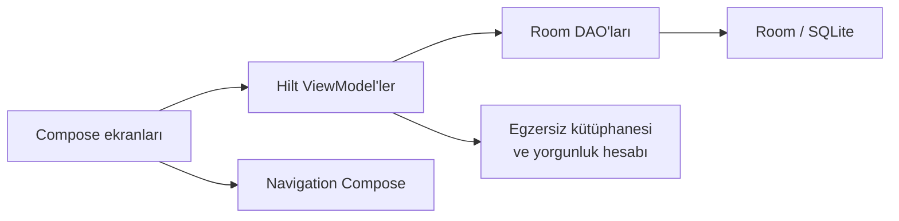
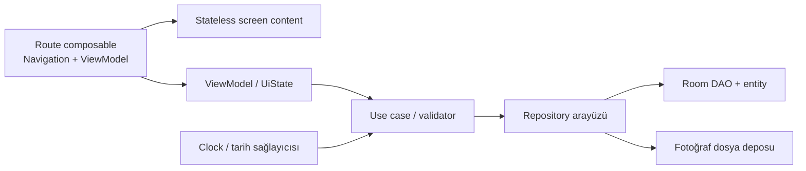

# GymTracker Proje Analiz Raporu

> İnceleme tarihi: 14 Temmuz 2026
> İncelenen dal/commit: `master` / `a8e019e`
> Kapsam: kaynak kod, mimari, veri modeli, kullanıcı akışları, test edilebilirlik, güvenlik/gizlilik, derleme ve yayın hazırlığı

> Ayrıntılı uygulama, modern UI/UX ve sprint planı: [`GELISTIRME_MASTER_PLANI.md`](GELISTIRME_MASTER_PLANI.md)

> Obsidian bilgi grafı ve oturum başlangıcı: [`docs/obsidian/00_START_HERE.md`](docs/obsidian/00_START_HERE.md)

## 1. Yönetici özeti

GymTracker; antrenman, vücut ölçümü, beslenme, ilerleme fotoğrafı, hazır program ve kas yükü haritasını tek bir çevrimdışı Android uygulamasında birleştiren, işlevsel bir prototiptir. Jetpack Compose, Room, Hilt, Kotlin Flow ve tek-activity yaklaşımı doğru bir başlangıç teknolojisi setidir. Uygulama derlenmekte ve debug APK üretilebilmektedir.

Ancak mevcut hali üretim sürümü için hazır değildir. En önemli nedenler şunlardır:

1. Room sürüm yükseltmesinde `fallbackToDestructiveMigration()` bütün kullanıcı verisini silebilir; migration ve şema geçmişi yoktur.
2. Fotoğraflarda yalnızca geçici `content://` URI saklanmaktadır; uygulama/cihaz yeniden başladıktan sonra erişim kaybolabilir.
3. Program başlangıç verisi yarış koşuluna açıktır, transaction içinde değildir ve tekrar üretilebilir veya yarım kalabilir.
4. Ana ekran ve kas yükü ekranı tam reaktif değildir; bazı değişiklikler ekrana yansımaz veya yalnızca ekran yeniden yaratılınca görünür.
5. Navigasyonda tanımlanmış detay rotaları gerçek veri parametreleriyle kullanılmamaktadır; program detayındaki satın alma diyaloğu kod akışı nedeniyle açılamaz.
6. Otomatik test yoktur. Lint 1 hata ve 46 uyarıyla başarısızdır. Gradle Wrapper dosyaları depoda eksiktir.
7. Girdi doğrulama, hata durumu, yaşam döngüsüne duyarlı state toplama, erişilebilirlik ve gizlilik ayarları yetersizdir.

Genel değerlendirme: **iyi kapsamlı ve gösterilebilir bir MVP/prototip, fakat veri güvenliği ve otomasyon temeli kurulmadan gerçek kullanıcıya açılmamalı.** Öncelik yeni özellik eklemek değil; veri kaybını önlemek, akışları reaktif hale getirmek ve güvenilir bir test/CI tabanı kurmaktır.

### Olgunluk görünümü

| Alan | Durum | Kısa değerlendirme |
|---|---:|---|
| Ürün kapsamı | Orta/iyi | Altı ana özellik alanı mevcut |
| Kodun derlenebilirliği | Orta | Debug build başarılı, standart wrapper eksik |
| Mimari | Orta | Katman niyeti var, sınırlar henüz zayıf |
| Veri güvenliği | Zayıf | Destructive migration ve kırılabilir fotoğraf URI’leri |
| Test edilebilirlik | Çok zayıf | Test kaynak setleri ve testler yok |
| Yayın hazırlığı | Zayıf | Lint kırmızı, release yapılandırması eksik |
| Güvenlik/gizlilik | Zayıf/orta | Ağ ve secret yok; izin/backup/veri politikası yetersiz |
| UX/erişilebilirlik | Orta/zayıf | Ana akışlar var, doğrulama ve responsive tasarım eksik |

Bu puanlama kod kalitesini küçümsemek için değil, geliştirme sırasını belirlemek içindir.

## 2. İnceleme kapsamı ve doğrulama sonuçları

### Depo özeti

- Tek Android uygulama modülü: `:app`
- 31 Kotlin dosyası, yaklaşık 3.624 Kotlin satırı
- 44 kaynak dosyası, yaklaşık 944 KB ham kaynak boyutu
- 83 takip edilen dosya
- Git geçmişinde tek commit: `Initial commit: GymTracker Android app`
- Çalışma ağacı inceleme başında ve doğrulama sonunda temizdi
- README, katkı rehberi, lisans, CI yapılandırması ve mimari karar kaydı yok

### Çalıştırılan kontroller

| Kontrol | Sonuç |
|---|---|
| Kotlin/KSP/Hilt debug derleme | Başarılı |
| `assembleDebug` | Başarılı |
| Üretilen debug APK | `app-debug.apk`, 18.829.574 bayt |
| `testDebugUnitTest` | `NO-SOURCE`; çalıştırılacak test yok |
| `lintDebug` | Başarısız: 1 hata, 46 uyarı |
| Egzersiz kütüphanesi tutarlılığı | 82 tanım, 82 benzersiz ad |
| Program–egzersiz referansları | 108 referansın tamamı kütüphanede mevcut |
| Kas görsel kaynakları | 38 görselin tamamı 470×836 |

Derleme, depoda wrapper bulunmadığı için makinedeki önbelleğe alınmış Gradle 8.4 ve JDK 17 açıkça seçilerek yapıldı. Makinenin varsayılan `java` komutu Java 11 göstermektedir. Bu durum yeni bir geliştiricinin projeyi doğrudan derleyemeyeceğini gösterir.

### Lint özeti

Lint’in tek hatası, kullanılmayan `CAMERA` izninin kamera donanımını dolaylı olarak zorunlu göstermesidir. Ayrıca şu uyarılar üretildi:

- `targetSdk = 34` güncel platformun gerisinde.
- Android 14 seçili fotoğraf erişimi ele alınmıyor.
- AGP, Compose BOM, Room, Lifecycle, Navigation ve diğer bazı bağımlılıklar eski.
- Beş adet `*_temp.png` kullanılmıyor.
- Adaptive ikonlarda monochrome katmanı yok.
- `mipmap-anydpi-v26` klasörü `minSdk = 26` nedeniyle gereksiz.

46 sayısı aynı sürüm uyarılarının farklı analiz varyantlarında tekrar edilmesini de içerir; 46 farklı fonksiyonel hata anlamına gelmez.

## 3. Şu ana kadar yapılmış olanlar

### Ürün özellikleri

1. **Ana ekran**
   - Toplam ve son yedi günlük antrenman sayısı
   - Son kilo ve günlük kalori özeti
   - Son antrenman kartı
   - Altı hızlı erişim kartı

2. **Antrenman takibi**
   - Antrenman oturumu başlatma
   - Kategori ve egzersiz seçerek set ekleme
   - Set/sayı/tekrar/ağırlık saklama ve silme
   - Süre ve not ile antrenmanı bitirme
   - Geçmiş oturumları listeleme

3. **Vücut ölçümleri**
   - Kilo, yağ oranı ve çevre ölçülerini saklama
   - Son ölçüm özeti ve geçmiş listesi
   - Kayıt silme

4. **Beslenme**
   - Özel besin oluşturma
   - Öğün bazlı tüketim kaydı
   - Kalori ve makro toplamları
   - Günlük hedef düzenleme

5. **İlerleme fotoğrafları**
   - Galeriden görsel seçme
   - Açı, kilo ve not bilgisi saklama
   - Açıya göre filtreleme ve grid görünümü

6. **Programlar**
   - İki ücretsiz, üç demo premium program
   - Program günü ve egzersiz detayı
   - Demo satın alma durumu

7. **Kas yükü haritası**
   - 82 egzersizli sabit egzersiz kütüphanesi
   - Ön/arka vücut görseli ve 38 maske kaynağı
   - Son yedi günlük setlerden kas bazlı hacim hesabı
   - Tıklanabilir ve renk geçişli kas bölgeleri

### İyi yapılmış teknik seçimler

- **Kotlin + Compose:** Bu ürün tipi için hızlı iterasyon ve deklaratif state yönetimi açısından uygun.
- **Room:** Yerel ve offline-first veri için doğru temel.
- **Hilt:** Uygulama küçük olsa da bağımlılıkların testte değiştirilebilmesi ve büyüme için yararlı.
- **Flow/StateFlow:** DAO’ların çoğunda reaktif veri kaynağı seçilmiş olması doğru yön.
- **Tek activity ve Navigation Compose:** Ekran sayısı için yeterli ve sade.
- **Version catalog:** Bağımlılık sürümlerinin tek yerde tutulması iyi.
- **Foreign key/cascade:** `WorkoutSession → WorkoutSet` ve `Program → ProgramWorkout` ilişkilerinde silme bütünlüğü düşünülmüş.
- **Egzersiz adları tutarlı:** Hazır programlardaki bütün egzersizler egzersiz kütüphanesinde bulunuyor.
- **Kas maskeleri tutarlı:** Bütün bitmap’lerin aynı boyutta olması hit-test ve üst üste bindirme mantığını sadeleştiriyor.
- **Demo ödeme açıkça belirtilmiş:** Kullanıcıya gerçek ödeme yapılmadığı söyleniyor; prototip için doğru iletişim.

## 4. Mevcut mimari



Paketler `data`, `domain`, `di` ve `ui` olarak ayrılmıştır. Bu görünüşte katmanlıdır; fakat ViewModel’ler DAO’lara doğrudan bağlandığı, Room entity’leri UI’a kadar taşındığı ve iş kurallarının bir bölümü composable/ViewModel içinde kaldığı için katman sınırları tam değildir.

Bu yapı prototip için kabul edilebilir; bugün çok modüllü, ağır bir Clean Architecture’a geçmek gereksiz olur. Buna karşılık repository sınırı, domain modelleri, merkezi doğrulama ve zaman sağlayıcısı eklenmelidir.

## 5. Öncelikli bulgular

Öncelik tanımları:

- **P0:** Gerçek kullanıcıya çıkmadan çözülmeli; veri kaybı, güvenlik veya temel yayın engeli.
- **P1:** İlk stabilizasyon sprintinde çözülmeli; yanlış davranış veya temel bakım/test sorunu.
- **P2:** Sonraki kalite sprintinde çözülmeli; ölçek, UX veya teknik borç.
- **P3:** İyileştirme/fırsat.

### P0 — Veri migration’ı kullanıcı verisini silebilir

**Kanıt:**

- `DatabaseModule.kt:21-22`: `fallbackToDestructiveMigration()`
- `AppDatabase.kt:44-45`: veritabanı sürümü 3, `exportSchema = false`
- Migration sınıfı, şema çıktısı ve migration testi yok.

**Etki:** Entity veya tablo değişikliğiyle sürüm yükseltildiğinde Room uygun migration bulamazsa bütün veritabanını silip yeniden oluşturabilir. Antrenman, ölçüm, beslenme ve program satın alma durumu kaybolur.

**Öneri:**

1. `exportSchema = true` yap ve `room.schemaLocation` ayarla.
2. Mevcut yayınlanmış sürümler varsa v1→v2→v3 şemalarını gerçek cihaz/veritabanından çıkar.
3. Her sürüm için açık `Migration` tanımla.
4. `MigrationTestHelper` ile eski şemadan güncele veri koruma testi yaz.
5. `fallbackToDestructiveMigration()` kullanımını kaldır. Yalnızca açıkça önemsiz cache DB’sinde kullanılmalı.

**Kabul kriteri:** Eski sürümden yeni sürüme geçen örnek DB’de kayıt sayıları ve önemli alanlar korunuyor; CI migration testini çalıştırıyor.

### P0 — Fotoğraf kayıtları kalıcı değil

**Kanıt:**

- `ProgressScreen.kt:43`: `ActivityResultContracts.GetContent()`
- `ProgressViewModel.kt:25-29`: seçilen URI metin olarak Room’a yazılıyor.
- Kalıcı URI izni alınmıyor ve dosya uygulamanın iç depolamasına kopyalanmıyor.

**Etki:** Sağlayıcının verdiği geçici okuma yetkisi süreç/cihaz yeniden başladıktan sonra geçersiz olabilir. Grid’de kırık görseller oluşur. Backup’tan dönen URI’ler de başka cihazda anlamsızdır.

**Öneri:** İki güvenli seçenekten biri seçilmeli:

- `OpenDocument` ile URI al, `takePersistableUriPermission()` uygula ve izin kaybını hata durumuyla yönet.
- Daha güvenilir yaklaşım: görseli kontrollü boyutlandırıp uygulamanın iç depolamasına kopyala; DB’de uygulamaya ait yol ve metadata sakla. Thumbnail üret, EXIF yönünü düzelt ve silmede dosyayı da temizle.

Android Photo Picker kullanılırsa geniş `READ_MEDIA_IMAGES` iznine çoğu akışta ihtiyaç kalmaz.

**Kabul kriteri:** Fotoğraf uygulama kapatılıp açıldığında, cihaz yeniden başlatıldığında ve süreç öldürüldüğünde görüntüleniyor; erişim kaybında kullanıcıya hata gösteriliyor.

### P0/P1 — Yayın kalite kapısı çalışmıyor

**Kanıt:**

- `lintDebug`: 1 hata, 46 uyarı.
- `gradlew`, `gradlew.bat` ve `gradle-wrapper.jar` yok.
- `app/proguard-rules.pro` build dosyasında referanslı fakat dosya yok.
- Test kaynak seti ve test yok.
- CI yok.
- Varsayılan Java 11; AGP 8.3.x için JDK 17 açıkça belgelenmemiş.

**Etki:** Yeni bir makinede aynı build’in üretileceği garanti değil. Hatalar merge öncesi yakalanmıyor. `testDebugUnitTest` başarılı görünse bile gerçekte hiçbir test çalışmıyor.

**Öneri:** Wrapper’ı Gradle ile yeniden üretip üç wrapper dosyasını commit et; JDK 17 şartını README’ye yaz; `proguard-rules.pro` ekle; CI’da `testDebugUnitTest`, `lintDebug` ve `assembleDebug` çalıştır. Lint baseline ile mevcut sorunları saklamak yerine önce gerçek hatayı kapat.

**Kabul kriteri:** Temiz clone üzerinde tek komutla `./gradlew testDebugUnitTest lintDebug assembleDebug` yeşil.

### P1 — Program seed işlemi yarış koşuluna ve yarım veriye açık

**Kanıt:**

- `ProgramsViewModel.kt:22-26`: `StateFlow` ilk değeri boş liste ve `SharingStarted.WhileSubscribed` kullanıyor.
- `ProgramsViewModel.kt:49-52`: init sırasında `programs.value` okunup boşsa seed başlıyor.
- Program ve gün eklemeleri transaction değil.
- Program adında/seed anahtarında unique constraint yok.

**Etki:** ViewModel oluşturulduğunda DB akışı gerçek değeri henüz yayınlamadan `programs.value` boştur; seed tekrar çalışabilir ve kopya programlar oluşturabilir. Uygulama seed ortasında kapanırsa en az bir program var olduğu için sonraki açılış kalan programları tamamlamaz.

**Öneri:** Seed’i ViewModel’den çıkar. Room callback, prepackaged DB veya repository içindeki tek transaction kullan. Sabit bir `seedKey/contentVersion` alanı ve unique index ekle; upsert ile idempotent yap. Seed sürümünü ayrı metadata tablosunda tut.

**Kabul kriteri:** Seed işlemi art arda ve eşzamanlı on kez çağrılsa bile yalnızca beklenen beş program ve günleri bulunur; yarım transaction DB’ye yazılmaz.

### P1 — Ana ekran verileri eksik reaktif

**Kanıt:** `HomeViewModel.kt:45-61` yalnızca `getAllSessions()` akışını collect ediyor; her antrenman yayınında ölçüm ve beslenmenin bir defalık snapshot’ını alıyor.

**Etki:** Kullanıcı kilo veya öğün eklediğinde antrenman listesi değişmezse ana ekran güncellenmez. Gece yarısından sonra `todayStart` ve `weekAgo` ViewModel yeniden yaratılana kadar eski kalır.

**Öneri:** DAO’lardan latest measurement, günlük nutrition özeti ve session istatistiğini Flow olarak döndür; `combine` ile tek `HomeUiState` üret. Zamanı enjekte edilen `Clock` ve `java.time` ile modelle. Gün değişimini tetikleyecek seçili tarih/gün olayı ekle.

**Kabul kriteri:** Ölçüm veya öğün eklendiğinde antrenman eklemeden ana ekran anında güncellenir; gece yarısı doğru güne geçer.

### P1 — Detay navigasyonu ve satın alma akışı hatalı

**Kanıt:**

- `NavGraph.kt:10-18` detay rotaları tanımlı.
- `MainActivity.kt:63-68`: `sessionId` argümanı tanımlanıyor ancak okunmuyor; aynı parametresiz `WorkoutScreen()` çağrılıyor.
- `ProgramDetail` rotası `NavHost` içine hiç eklenmemiş.
- `ProgramsScreen.kt:37-45`: detay çizildikten sonra composable’dan erken `return` ediliyor.
- Satın alma diyaloğu `ProgramsScreen.kt:89-98` satırlarında, yani detaydaki erken return’den sonra çiziliyor.

**Etki:** URL/deep link veya saved back stack üzerinden doğru detay yüklenmez. Program detay ekranındaki “Satın Al” butonu state’i değiştirse de diyalog çizilemez. Yerel `selectedProgram` nesnesi satın alma sonrası eski `isPurchased` değerini de tutar. Sistem geri tuşu yerel detay state’ini beklenen şekilde yönetmez.

**Öneri:** Liste ve detayları gerçek navigation destination yap; yalnızca ID taşı. ViewModel’de `SavedStateHandle`/type-safe route üzerinden ID al ve DB’den reaktif kayıt oku. Diyalog state’ini ilgili destination içinde çiz. Satın alma sonrası programı flow’dan güncel nesneyle göster.

**Kabul kriteri:** Liste, detay, sistem geri tuşu, süreç yeniden oluşturma ve doğrudan detail route testleri geçer; detaydan satın alma diyaloğu açılır ve başarı sonrası kilit anında kalkar.

### P1 — “Yorgunluk” hesabı kullanıcıya olduğundan kesin sunuluyor

**Kanıt:**

- `FatigueCalculator.kt`: `reps × weight × sabit activation` hacmi, sabit haftalık maksimuma bölünüyor.
- `FatigueViewModel.kt:24-33`: veri yalnızca init sırasında bir defa yükleniyor.
- `WorkoutSet.isCompleted` hesapta dikkate alınmıyor.
- Vücut ağırlığı hareketlerinde ağırlık varsayılan olarak `0`, dolayısıyla katkı sıfır.
- RPE/RIR, set yaşı, toparlanma hızı, uyku, antrenman sıklığı ve kişisel kapasite yok.
- Egzersiz adı string eşleşmezse set sessizce hesaba katılmıyor.

**Etki:** Harita gerçek fizyolojik yorgunluk değil, yaklaşık dış yük dağılımını gösterir. “% yorgunluk” ifadesi kullanıcıda bilimsel kesinlik algısı yaratabilir. Yeni set ekledikten sonra mevcut ekran otomatik yenilenmez.

**Öneri:** İlk aşamada adı **“7 Günlük Kas Yükü Haritası”** olarak değiştir ve metodolojiyi açıkla. Hesabı saf/test edilebilir use case yap. Yalnızca tamamlanan setleri al; bodyweight hareketleri için etkili yük veya set tabanlı puan kullan; zamanla azalan ağırlık ekle. İleri aşamada kişisel baseline ve RPE/RIR ile kalibre et. Egzersizi string yerine kararlı `exerciseId` ile bağla.

**Kabul kriteri:** Formül, sınırlar ve örnekler unit test ile sabit; yeni antrenman eklenince harita reaktif yenilenir; bilinmeyen egzersizler ölçümlenir veya görünür uyarı üretir.

### P1 — Beslenme tarih ve hedef hesaplarında doğruluk sorunları var

**Kanıt:**

- `NutritionViewModel` içinde `_selectedDate` var fakat değiştiren public fonksiyon ve tarih seçici UI yok.
- Yeni kayıt seçilen günün tam başlangıç zamanıyla kaydediliyor; gerçek öğün saati yok.
- Gün sonu `start + 86_400_000` olarak hesaplanıyor; yaz/kış saati geçişlerinde yerel gün her zaman 24 saat değildir.
- `NutritionScreen.kt:135`: progress önce `min(..., 1f)` ile kesiliyor; satır 140’taki `progress > 1f` hiçbir zaman true olamaz.
- Hedefler sıfır veya negatif kaydedilebilir; bölme sonucu `NaN/Infinity` oluşabilir.

**Öneri:** `LocalDate` + `ZoneId` ile `[startOfDay, nextStartOfDay)` üret. Tarih seçici ve önceki/sonraki gün navigasyonu ekle. Kayıtta gerçek timestamp ile log date’i ayır. Bütün hedef ve miktarlarda pozitif aralık doğrulaması yap. Gösterilecek progress’i ayrı clamp et; aşım bilgisini unclamped oranla hesapla.

### P1 — Girdi doğrulama ve hata yönetimi yok denecek kadar az

**Örnekler:**

- Boş ölçüm formu bütün alanları null olan kayıt oluşturabilir.
- Negatif kilo, tekrar, süre, kalori veya makro kaydedilebilir.
- Hatalı sayı sessizce `0`, `100`, `2500` gibi default değere dönüşüyor.
- Türkçe ondalık virgül `toFloatOrNull()` ile kabul edilmeyebilir.
- DAO hataları coroutine içinde yakalanmıyor; UI success/error bilgisi almıyor.
- Silme işlemlerinde geri alma veya onay yok.

**Öneri:** Domain seviyesinde ortak validator ve typed value/sonuç yapısı kullan. UI yalnızca geçerli formu submit edebilsin; alan altı hata göster. Locale-aware decimal parser ekle. ViewModel state’i `isLoading`, `fieldErrors`, `message` ve kalıcı içerik içersin. Silmede Snackbar undo tercih et.

### P1/P2 — Geçmiş antrenman ile aktif antrenman aynı state’e bağlanmış

**Kanıt:** Session kartına basınca `loadSession()` kaydı `activeSession` yapıyor; ekran “Aktif Antrenman” diyor ve eski oturuma set ekleme/bitirme sunuyor.

**Etki:** Geçmiş kayıt yanlışlıkla aktifmiş gibi düzenlenebilir. Başlatılıp terk edilen oturum DB’de tamamlanmamış kayıt olarak kalır; session silme UI’ı yoktur.

**Öneri:** `WorkoutSession` içine `status`, `startedAt`, `finishedAt` ekle. Aktif session ID’sini `SavedStateHandle` veya repository üzerinden sakla. Geçmiş detayını read-only aç; açık “Düzenle” moduna geçiş sun. Uygulama açılışında yarım oturumu devam ettir/iptal et seçeneği ver.

### P2 — Veri modeli büyümeye hazır değil

Başlıca noktalar:

- `ProgramWorkout.exercises` JSON string olarak tutuluyor. Sorgulanamaz, foreign key yok ve bozuk JSON `fromJson()` sırasında composable’ı çökertebilir.
- `FoodEntry.foodItemId` için foreign key yok. Besin snapshot’ı tutmak amaçlıysa bu tasarım açıkça belgelenmeli ve alan adı buna göre düzenlenmeli.
- Sık filtrelenen `date` alanlarında index yok: workout session, measurement, food entry ve progress photo.
- Para `Float` ile tutuluyor. Gerçek ödeme için minor unit (`Long`) ve para birimi kullanılmalı.
- Egzersiz ilişkileri ad string’iyle kuruluyor; yeniden adlandırma hesapları kırar.
- `WorkoutSet.setNumber` için `(sessionId, exerciseId, setNumber)` bütünlük kuralı yok.

Önerilen normalizasyon: `Exercise`, `ProgramDay`, `ProgramDayExercise`, `WorkoutSession`, `WorkoutSet` tablolarını kararlı ID’lerle bağla. UI gösterim adını ilişkiden ayrı tut.

### P2 — UI state ve Compose yaşam döngüsü iyileştirilmeli

- Ekranlar `collectAsState()` kullanıyor; `lifecycle-runtime-compose` eklenip `collectAsStateWithLifecycle()` kullanılmalı.
- Dialog, filtre ve seçili detay state’leri çoğunlukla `remember`; uygun yerlerde `rememberSaveable`/ViewModel kullanılmalı.
- Listelerde kararlı `key` verilmemiş.
- Loading/error state neredeyse yok; boş liste ile yükleniyor durumu ayırt edilemiyor.
- `WorkoutUiState.sessions` ve `isLoading` tanımlı fakat kullanılmıyor.
- `SimpleDateFormat` composable yeniden çizimlerinde tekrar yaratılıyor; `java.time` formatter ve `remember` kullanılmalı.
- Büyük composable dosyaları (392, 373, 426 satır) stateful route ve stateless content olarak ayrılmalı.

### P2 — Erişilebilirlik, responsive tasarım ve metin kaynakları

- Alt navigation’da yedi öğe var; dar ekranda etiketler sıkışır. 3–5 ana hedef + “Diğer” veya adaptive navigation rail/drawer düşünülmeli.
- Fotoğraf filtreleri beş chip’i kaydırmasız tek satıra koyuyor; küçük ekranda taşabilir.
- Bazı actionable icon’ların `contentDescription` değeri null.
- Set silme `IconButton` alanı 24 dp’ye düşürülmüş; dokunma hedefi küçüktür.
- Metinlerin hemen tamamı Kotlin içinde hardcoded; `strings.xml` yalnızca uygulama adını içeriyor.
- Font scaling, landscape, tablet, TalkBack ve contrast testleri yok.
- Kas haritasının görsel olmayan eşdeğeri yok; TalkBack kullanıcısı kas yüzdelerine liste olarak erişemiyor.

Öneri: Bütün kullanıcı metinlerini kaynaklara taşı; quantity/plural ve format argümanlarını kullan; responsive window size class uygula; kas yüzdelerini erişilebilir liste/legend ile sun.

### P2 — İzin, backup ve gizlilik politikası net değil

- `CAMERA` ve `READ_MEDIA_IMAGES` manifestte var, fakat mevcut akış kamera kullanmıyor ve `GetContent` sistem seçiciyi açıyor.
- `allowBackup="true"`; antrenman, kilo, beslenme ve fotoğraf metadata’sı varsayılan backup’a dahil olabilir.
- Backup/restore kuralları ve gizlilik politikası yok.
- Veritabanı şifreli değil. Android app sandbox temel koruma sağlar; tehdit modeline göre ek şifreleme değerlendirilmeli.

Öneri: Kullanılmayan izinleri kaldır. Sistem Photo Picker ile izin yüzeyini küçült. `dataExtractionRules`/backup politikasını ürün kararıyla tanımla. Hassas alanların backup’a girip girmeyeceğini açıkça seç. Log ve crash raporlarında sağlık verisini maskele.

### P2 — Demo premium modeli gerçek ürüne taşınamaz

`isPurchased` tek bir yerel boolean’dır; kullanıcı veriyi değiştirerek premium kilidini açabilir. Bu demo için sorun değildir ve UI bunu açıkça söylüyor. Gerçek ücretli ürün hedefleniyorsa Play Billing, purchase token doğrulama, restore purchases ve tercihen sunucu tarafı entitlement gereklidir. Para/ülke/vergi modeli de ürün kararıdır.

### P3 — Bağımlılık ve kaynak temizliği

- Lint’e göre bağımlılıkların çoğu 2024 seviyesinde kalmış. Hepsini tek seferde yükseltmek yerine uyumluluk matrisiyle küçük PR’lar yapılmalı.
- `datastore-preferences` dependency’si kullanılmıyor.
- Version catalog’da `accompanist` sürümü tanımlı fakat library kullanılmıyor.
- Beş `*_temp.png` kullanılmıyor.
- `material-icons-extended` geniş bir bağımlılık; yalnızca gerekli ikonları vektör kaynak olarak taşımak değerlendirilebilir.
- Release build’de minification kapalı. Yayın öncesi R8/resource shrinking açılıp release smoke testi yapılmalı.

## 6. Önerilen hedef mimari

Proje bugün tek Gradle modülünde kalabilir. Önce paket ve sorumluluk sınırları güçlendirilmelidir:



### Önerilen paket düzeni

```text
com.gymtracker
├── core
│   ├── time
│   ├── validation
│   ├── model
│   └── ui
├── data
│   ├── local
│   │   ├── dao
│   │   ├── entity
│   │   ├── migration
│   │   └── seed
│   ├── repository
│   └── files
├── domain
│   ├── model
│   ├── repository
│   └── usecase
└── feature
    ├── home
    ├── workout
    ├── nutrition
    ├── measurements
    ├── progress
    ├── programs
    └── workload
```

### Mimari karar önerileri

1. **Local-first yaklaşımı koru.** Mevcut ürün çevrimdışı kullanım için uygun; erken backend eklemek zorunlu değil.
2. **Repository sınırı ekle.** DAO’yu ViewModel’den ayır; transaction, entity→domain mapping ve hata dönüşümü repository’de olsun.
3. **Her şeye interface yazma.** Yalnızca veri, dosya, saat ve ödeme gibi dış sınırlar interface olmalı.
4. **Single source of truth Room olsun.** UI mutation sonrası manuel yeniden sorgu yerine Room Flow’dan güncellensin.
5. **Zaman bağımlılığını enjekte et.** `Clock` ile gece yarısı, zaman dilimi ve test senaryoları kontrol edilsin.
6. **Entity’leri UI’a taşıma.** UI/domain modeli ile depolama modeli ayrılınca migration ve gösterim değişiklikleri daha güvenli olur.
7. **Çok modüle hemen geçme.** Ekip büyür, build süresi sorun olur veya özellik sınırları oturursa `core`, `data`, `feature:*` modülleri ayrılabilir.
8. **UI state’i açık modelle.** `Loading / Content / Empty / Error` veya eşdeğer data class; tek seferlik UI mesajları için kontrollü event akışı.

## 7. Test stratejisi

### Unit test

- Kas yükü formülü: bilinen egzersiz, bilinmeyen egzersiz, bodyweight, tamamlanmamış set, sınır değerleri
- Beslenme toplamı ve progress hesabı
- Locale-aware sayı doğrulama
- Tarih aralığı: normal gün, yaz/kış saati geçişi, zaman dilimi değişimi
- Program JSON geçiş sürecinde serializer’ın bozuk veri davranışı
- ViewModel state dönüşümleri; coroutine test + Turbine

### Room/instrumentation test

- Cascade delete
- Gün/tarih aralığı sorguları
- Unique constraint’ler
- Seed idempotency ve transaction rollback
- Bütün migration yolları
- `WorkoutDao.getSetsSince()` sorgusu düzeltilmeli veya kullanılmıyorsa kaldırılmalı; mevcut `date(sessionId)` ifadesi session ID’yi tarih gibi yorumlamaktadır.

### Compose UI test

- Antrenman başlat → set ekle → bitir
- Geçmiş antrenman read-only davranışı
- Öğün ekle ve ana ekranın reaktif güncellenmesi
- Boş/geçersiz form doğrulaması
- Program detayından satın alma diyaloğu
- Fotoğraf erişim hatası ve silme
- Geri tuşu ve process recreation

### Manuel ve cihaz matrisi

- minSdk 26 cihaz/emülatör
- Güncel target cihaz
- Dar telefon, landscape, tablet/foldable
- Türkçe ve en az bir ikinci locale
- Font scale %200, TalkBack, dark contrast
- Düşük bellek ve süreç öldürme

## 8. Geliştirme yol haritası

### Aşama 0 — Tekrarlanabilir build ve kalite kapısı (1–3 gün)

1. Gradle Wrapper dosyalarını geri ekle.
2. JDK 17 ve kurulum adımlarını README’de belgele.
3. Kullanılmayan kamera/medya izinlerini kaldır veya doğru feature/picker davranışını kur.
4. Lint hatasını kapat, kullanılmayan temp kaynakları temizle.
5. `proguard-rules.pro` ekle.
6. İlk unit test altyapısını ve CI iş akışını kur.
7. Kullanılmayan bağımlılıkları temizle.

**Çıkış kriteri:** Temiz clone’da test + lint + debug build yeşil.

### Aşama 1 — Veri güvenliği (3–6 gün)

1. Şema export ve migration altyapısı.
2. Migration testleri.
3. Program seed’ini idempotent transaction’a taşıma.
4. Fotoğrafı iç depolamaya alma veya persistable URI çözümü.
5. Backup/data extraction politikası.
6. Tarih index’leri ve eksik bütünlük kuralları.

**Çıkış kriteri:** Upgrade veri kaybetmiyor; fotoğraflar restart/reboot sonrasında çalışıyor; seed tekrar üretmiyor.

### Aşama 2 — Doğruluk ve reaktif state (4–7 gün)

1. Home verilerini `combine` edilen Flow’lara dönüştür.
2. Workload/fatigue ekranını reaktif ve doğru adlandırılmış hale getir.
3. `java.time` + `Clock` ile gün aralıklarını düzelt.
4. Form doğrulama ve UI error state.
5. Aktif/geçmiş antrenman ayrımı.
6. Navigation detay rotalarını ID tabanlı kur.
7. Program detayındaki satın alma ve stale state hatasını gider.

**Çıkış kriteri:** Ana akışların state ve process recreation testleri geçer; hatalı input DB’ye gitmez.

### Aşama 3 — Mimari ve UX sağlamlaştırma (5–10 gün)

1. Repository + domain model/use case sınırı.
2. Program egzersiz JSON’unu ilişkisel tabloya migration.
3. Lifecycle-aware state collection.
4. Stateless content composable’ları ve preview’lar.
5. String resource, erişilebilirlik ve adaptive navigation.
6. Liste key’leri, loading/empty/error state ve undo.
7. Dependency yükseltmelerini küçük, testli PR’lara bölme.

### Aşama 4 — Ürün geliştirme (ürün kararına bağlı)

- Programdan doğrudan antrenman başlatma ve takvimleme
- Ölçüm/performans grafikleri ve kişisel rekorlar
- CSV/JSON dışa aktarma ve kontrollü yedekleme
- Bulut senkronizasyonu ve hesap sistemi
- Gerçek premium hedefleniyorsa Play Billing + entitlement backend
- Kullanıcı ayarları: birim sistemi, dil, tema, haftanın başlangıcı
- Gizlilik politikası, analitik ve crash reporting için açık rıza/maskeleme

## 9. İlk backlog önerisi

| Sıra | İş | Öncelik | Yaklaşık boyut |
|---:|---|---:|---:|
| 1 | Wrapper + README + JDK 17 + CI | P0/P1 | S |
| 2 | Lint hatası ve kullanılmayan izinler | P0/P1 | XS |
| 3 | Room schema export + migration altyapısı/testi | P0 | M/L |
| 4 | Fotoğraf kalıcı saklama | P0 | M |
| 5 | Program seed transaction/idempotency | P1 | M |
| 6 | Program/detail navigation ve purchase bug | P1 | M |
| 7 | Home reactive `combine` | P1 | M |
| 8 | Tarih/Clock ve nutrition doğruluğu | P1 | M |
| 9 | Merkezi form validation | P1 | M |
| 10 | Aktif/geçmiş workout state modeli | P1 | M |
| 11 | Fatigue → workload modeli ve testleri | P1 | M/L |
| 12 | Repository/domain sınırı | P2 | L |
| 13 | Program egzersizlerini normalize etme | P2 | L |
| 14 | String resources + accessibility + adaptive nav | P2 | L |
| 15 | Kontrollü bağımlılık/target SDK yükseltmesi | P2 | M/L |

`XS/S/M/L` değerleri ekip ve mevcut ürün kararları bilinmeden verilmiş göreli boyutlardır.

## 10. Başarı ölçütleri

Stabilizasyon tamamlandı sayılmadan önce şu koşullar sağlanmalı:

- Temiz clone tek wrapper komutuyla derleniyor.
- CI test, lint ve debug build’i zorunlu kalite kapısı yapıyor.
- Lint error sayısı sıfır.
- En az kritik domain hesapları, DAO sorguları, seed ve migration yolları testli.
- DB sürüm yükseltmesinde kullanıcı verisi korunuyor.
- Fotoğraflar süreç/cihaz yeniden başlatmada kırılmıyor.
- Home ve workload ekranı veri değişimlerine reaktif.
- Geçersiz/negatif/boş veri DB’ye yazılmıyor.
- Navigation ID tabanlı, geri tuşu ve process recreation güvenli.
- Kullanılmayan hassas izin yok; backup politikası açık.
- Release varyantı imzalama dışındaki bütün adımlarla CI’da üretilebiliyor ve smoke testten geçiyor.

## 11. Son karar

Mevcut teknoloji seçimi genel olarak doğrudur; problem teknoloji değil, üretim güvenilirliğini sağlayan katmanların henüz tamamlanmamış olmasıdır. Compose + Room + Hilt korunmalı. Şu anda büyük bir yeniden yazım veya hemen çok modüllü mimari önerilmez. En etkili yol:

1. Build/test/migration temelini kurmak,
2. Veri kaybı ve fotoğraf kalıcılığını çözmek,
3. State ve navigasyon hatalarını gidermek,
4. Ardından repository/domain sınırını ve UX kalitesini kademeli güçlendirmektir.

Bu sıra izlendiğinde mevcut kodun önemli bölümü korunabilir ve prototip, ölçülebilir şekilde stabil bir yerel-first ürüne dönüştürülebilir.
