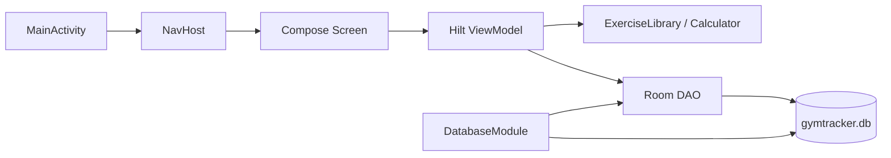

# Mimari — Mevcut Sistem

## Çalışan zincir

## Güçlü taraflar

- Tek activity ve sade Compose başlangıcı
- DAO’ların çoğunda Flow
- Hilt singleton DB
- Version catalog
- Session→Set ve Program→Workout cascade ilişkisi

## Sınır ihlalleri

- ViewModel doğrudan DAO alır; repository yok.
- Room entity UI’a kadar çıkar.
- Ekran dosyaları form validation ve formatlama içerir.
- `MainActivity` navigation graph’ı da taşır.
- Program seed ViewModel içinde içerik/depolama sorumluluğu alır.

## Değişim yönü

[[ARCH_TARGET_SYSTEM]] bir big-bang rewrite değildir. İlk dikey örnek Home veya Navigation shell olmalı; ardından [[FEATURE_WORKOUT]] taşınmalıdır.

İlgili: [[ARCH_STATE_DATA_FLOW]], [[ARCH_DATABASE]], [[ARCH_BUILD_DI]].
