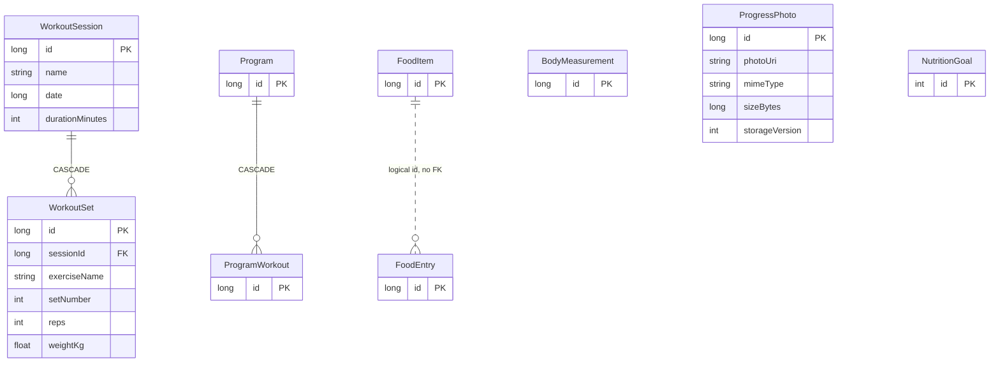

> Update (2026-07-14, v5): `ProgressPhoto` için `mimeType`, `sizeBytes` ve `storageVersion` kolonları eklendi. `MIGRATION_4_5`, v3→v5 fixture koruma testi ve v3/v4/v5 schema JSON’ları kaynak kontrolündedir. Legacy fotoğraflar `storageVersion=0`, yeni app-owned importlar `storageVersion=1` olur.

> Implementation update (2026-07-14): `exportSchema=true`; v3 schema hash `bb80650678afbc615c5dec81809ab042` is stored under `app/schemas`; `fallbackToDestructiveMigration()` is removed; migrations are registered through `DatabaseMigrations.ALL`. [[DatabaseMigrationTest]] and [[WorkoutDaoTest]] pass on the API 34 emulator. v3 is the minimum evidence-backed migration baseline.

# Mimari — Room Veritabanı

## Mevcut ER

## DAO sahipliği

| DAO | Tablolar | Feature |
|---|---|---|
| WorkoutDao | sessions, sets | [[FEATURE_WORKOUT]], [[FEATURE_HOME]], [[FEATURE_MUSCLE_LOAD]] |
| MeasurementDao | measurements | [[FEATURE_MEASUREMENTS]], [[FEATURE_HOME]] |
| NutritionDao | food items/entries/goals | [[FEATURE_NUTRITION]], [[FEATURE_HOME]] |
| ProgressPhotoDao | photos | [[FEATURE_PROGRESS_PHOTOS]] |
| ProgramDao | programs/workouts | [[FEATURE_PROGRAMS]] |

## Kritik mevcut gerçekler

- DB version 5, `exportSchema=true`; v3, v4 ve v5 schema JSON’ları version control altında.
- Destructive fallback kaldırıldı; bilinmeyen sürümler veri silmek yerine fail-closed davranır.
- `DatabaseMigrations.ALL`, 3→4 ve 4→5 kenarlarını kaydeder; v3→latest satır koruma testi API 34’te geçer.
- `ProgramWorkout.exercises` JSON string.
- Tarih kolonlarında index yok.
- `WorkoutDao.getSetsSince()` içindeki `date(sessionId)` semantik olarak yanlış ve kullanılmıyor.
- Program seed tek Room transaction’ı ve `seed_metadata` claim’i ile idempotenttir.
- Fotoğraf byte’ları Room içinde BLOB değildir; app internal storage’da, DB’de URI ve metadata tutulur.

## Hedef değişiklikler

- [[ADR_003_EXPLICIT_ROOM_MIGRATIONS]]
- Workout status/startedAt/finishedAt/exerciseId/position
- ProgramDayExercise ilişkisel tablo
- Program seedKey/contentVersion unique
- Photo thumbnail/dimension/media-transform metadata ve legacy re-import UX
- Tarih ve compound index’ler
- Para minor unit/currency

Her değişiklikte [[CHANGE_IMPACT_MAP#Room entity veya kolon değişikliği]] uygulanır.
