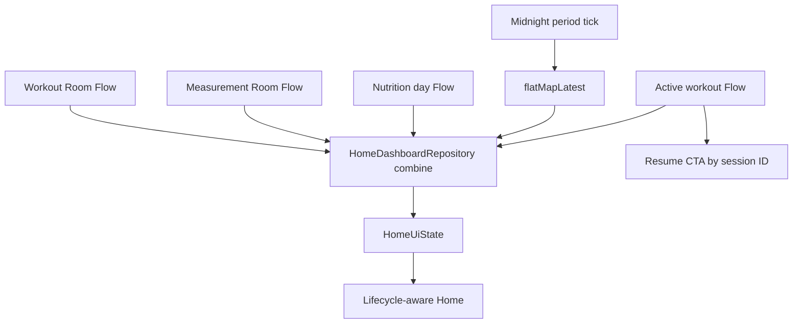

# Mimari — State ve Veri Akışı

## Uygulanan iskelet

- Home: workout + measurement + günün nutrition Room Flow’ları `HomeDashboardRepository.combine` ile tek state üretir.
- Home ViewModel: `Loading/Content/Error`, retry ve yerel gece yarısında period Flow’unu `flatMapLatest` ile yeniden kurma uygular.
- Workout: active/completed Room Flow’ları ayrı state üretir; detail ID `SavedStateHandle` kaynağındandır. Mutation repository/transaction sınırından geçer ve hata state’i UI’da gösterilir.
- Program list/detail: ilişkisel repository Flow → ViewModel `Loading/Content/Error`; detail ID `SavedStateHandle` kaynağındandır. Program günü başlatma, locked/ownership/target doğrulaması ve active-session kontrolüyle tek transaction’da planlanan WorkoutSet’ler üretir.
- Nutrition: seçili `LocalDate` ISO biçiminde `SavedStateHandle` içinde korunur; `Clock`/dinamik sistem `ZoneId` ile takvim günü aralığı hesaplanır ve `flatMapLatest` yeni Room Flow’una geçer. Edit snapshot-safe update’tir; delete aynı-ID Snackbar undo state’i üretir.
- Measurements: `MeasurementRepository` all + indexed period Flow’larını ayırır. `SavedStateHandle` içindeki chart period `flatMapLatest` ile 7/30/90/tümü query’sini seçer; `MeasurementsUiState(latest, history, weightTrend, chartMeasurements)` üretir. Edit/update ve delete/aynı-ID undo Room Flow üzerinden Home ve UI’yı yeniler.
- Muscle Load: takvim tabanlı son yedi gün period Flow’u `flatMapLatest` ile completed-set Room Flow’una geçer; saf calculator loading/content/error state üretir ve gece yarısında query sınırını yeniler.
- Bütün ana Compose ekranları `collectAsStateWithLifecycle()` kullanır.
- Programdan gelen `WorkoutSet.isCompleted=false` satırları gerçek reps/kg mutation’ıyla tamamlanır; çözülmemiş planlı set varken finish reddedilir ve Muscle Load yalnız session + set tamamlandığında etkilenir.
- Gün sınırı sabit 86.400.000 ms yerine `ZoneId` + takvim günü ile hesaplanır; tarihsel Istanbul DST unit testi vardır.

## Kalan desenler

- Nutrition seçili gün process recreation’da korunur; gece yarısında otomatik bugün tick’i ve gerçek process-death testi bekler.
- Home rollover çalışır; Clock/ZoneId injection, timezone-change gözlemi ve deterministik ViewModel testi bekler.

## Sorun grafı

## Hedef desen

- Repository Flow’ları `combine/flatMapLatest` ile use case içinde birleştir.
- ViewModel `stateIn(WhileSubscribed)` ile `UiState` üretir.
- UI `collectAsStateWithLifecycle()` kullanır.
- Mutation DB’ye yazılır; Room Flow yeni state’i yayınlar.
- Tek seferlik hata/undo mesajı açık event/state tüketimiyle yönetilir.
- Tarih seçimi `LocalDate`; gün sınırı `Clock/ZoneId`.

## İlk dönüşümler

1. [[FEATURE_WORKOUT]] — status/read-only detail ve active session sözleşmesi tamamlandı.
2. [[FEATURE_NUTRITION]] — selectedDate setter, SavedStateHandle, Clock ve DST-safe range tamamlandı.
3. [[FEATURE_MUSCLE_LOAD]] — son yedi günlük tamamlanmış set Flow + günlük rollover tamamlandı.
4. [[FEATURE_HOME]] — Clock injection; aktif-seans CTA entegrasyonu tamamlandı.
5. [[FEATURE_MEASUREMENTS]] — validation/latest/history/trend, repository sınırı, SavedState period ve gerçek chart Flow’u tamamlandı.
6. [[FEATURE_PROGRAMS]] — ilişkisel plan Flow’u, locked repository guard ve atomic program→planned-workout entegrasyonu tamamlandı.

Test eşleşmesi: [[TEST_MATRIX#ViewModel ve state]].
