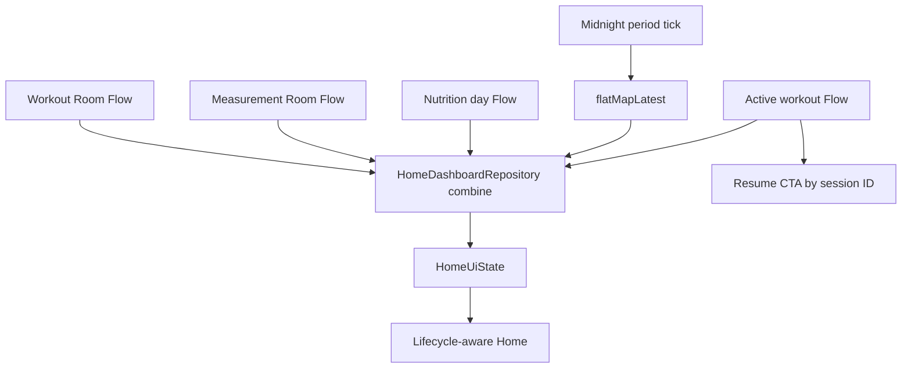

# Mimari — State ve Veri Akışı

## Uygulanan iskelet

- Home: workout + measurement + günün nutrition Room Flow’ları `HomeDashboardRepository.combine` ile tek state üretir.
- Home ViewModel: `Loading/Content/Error`, retry ve yerel gece yarısında period Flow’unu `flatMapLatest` ile yeniden kurma uygular.
- Workout: active/completed Room Flow’ları ayrı state üretir; detail ID `SavedStateHandle` kaynağındandır. Mutation repository/transaction sınırından geçer ve hata state’i UI’da gösterilir.
- Program list ve detail: repository Flow → ViewModel `stateIn(WhileSubscribed)`; detail ID `SavedStateHandle` kaynağındandır.
- Nutrition: seçili `LocalDate` ISO biçiminde `SavedStateHandle` içinde korunur; `Clock`/dinamik sistem `ZoneId` ile takvim günü aralığı hesaplanır ve `flatMapLatest` yeni Room Flow’una geçer. Mutation validation/error state üzerinden yönetilir.
- Measurements: DAO Flow’u `MeasurementsUiState(latest, history, weightTrend)` üretir; latest geçmişten ayrılır ve saf validation/trend kuralları yazma öncesinde çalışır.
- Bütün ana Compose ekranları `collectAsStateWithLifecycle()` kullanır.
- Gün sınırı sabit 86.400.000 ms yerine `ZoneId` + takvim günü ile hesaplanır; tarihsel Istanbul DST unit testi vardır.

## Kalan desenler

- Fatigue: init sırasında tek suspend query; reaktif değil.
- Nutrition seçili gün process recreation’da korunur; gece yarısında otomatik bugün tick’i ve gerçek process-death testi bekler.
- Home rollover çalışır; Clock/ZoneId injection, timezone-change gözlemi ve deterministik ViewModel testi bekler.

## Sorun grafı

## Hedef desen

- Repository Flow’ları `combine/flatMapLatest` ile use case içinde birleştir.
- ViewModel `stateIn(WhileSubscribed)` ile `UiState` üretir.
- UI `collectAsStateWithLifecycle()` kullanır.
- Mutation DB’ye yazılır; Room Flow yeni state’i yayınlar.
- Tek seferlik hata/undo mesajı açık event/state tüketimiyle yönetilir.
- Tarih seçimi `LocalDate`; gün sınırı `Clock/ZoneId`.

## İlk dönüşümler

1. [[FEATURE_WORKOUT]] — status/read-only detail ve active session sözleşmesi tamamlandı.
2. [[FEATURE_NUTRITION]] — selectedDate setter, SavedStateHandle, Clock ve DST-safe range tamamlandı.
3. [[FEATURE_MUSCLE_LOAD]] — son N günlük tamamlanmış set Flow.
4. [[FEATURE_HOME]] — Clock injection; aktif-seans CTA entegrasyonu tamamlandı.
5. [[FEATURE_MEASUREMENTS]] — validation/latest/history/trend state’i tamamlandı; chart ve repository sınırı bekliyor.

Test eşleşmesi: [[TEST_MATRIX#ViewModel ve state]].
