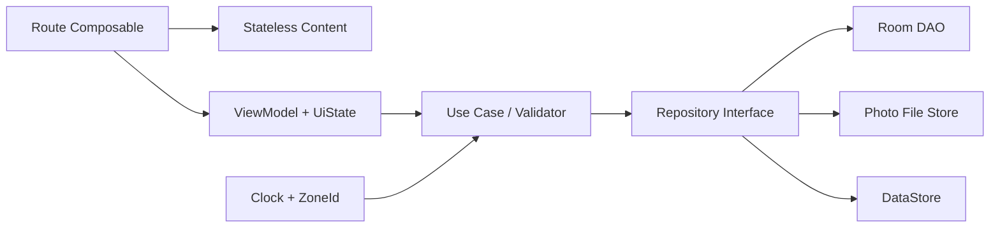

# Mimari — Hedef Sistem

## Hedef zincir

## Kurallar

1. UI Room entity bilmez.
2. ViewModel SQL/dosya yolu bilmez.
3. Room tek kalıcı kaynak; mutation sonrası manuel liste reload edilmez.
4. Zaman `Clock/ZoneId` üzerinden gelir.
5. Route yalnızca ID taşır; destination DB Flow’undan güncel nesneyi alır.
6. `UiState` loading/content/empty/error ayrımını taşır.
7. Tek modül korunur; paket sınırları oturmadan multi-module yapılmaz.

## İlk referans dilim

`HomeRepository` + `ObserveHomeStatsUseCase` + `HomeUiState` + `HomeRoute/HomeContent`. Bu dilim [[FEATURE_HOME]] stale state hatasını da çözer.

## Sonraki dilim

[[FEATURE_WORKOUT]] için aktif session state, auto-save ve process recreation.

Karar: [[ADR_001_LOCAL_FIRST_SINGLE_MODULE]]. Test: [[TEST_MATRIX]].
