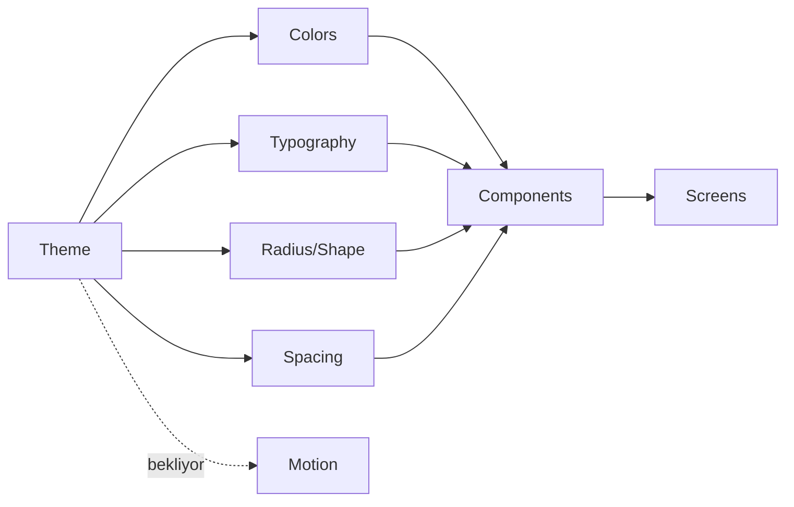

# Tasarım Sistemi Grafı

## Uygulanan temel

- `GymTrackerTheme`, sistem moduna bağlı light/dark Material 3 renk şeması kullanır; platform açılış penceresi de `values`/`values-night` ile aynı yüzeye geçer.
- `DesignTokens.kt`: ortak typography, spacing, shape ve minimum 48 dp touch/icon/content-width ölçülerini tanımlar.
- `GymTrackerComponents.kt`: `GtSectionHeader`, `GtMetricCard`, `GtQuickActionCard`, `GtLoadingState`, `GtEmptyState`, `GtErrorState` bileşenlerini sağlar.
- Home referans ekran olarak bu bileşenlere taşındı; bottom navigation %200 fontta yalnız seçili etiketi göstererek çok satırlı taşmayı önler.
- Workout aktif/geçmiş liste ve detayları aynı token/state bileşenlerini tüketir; %200 fontta kart ve detay başlıkları dikey yerleşime geçer.
- Nutrition tarih/kalori/makro/öğün ve Measurements latest/trend/history/empty yüzeyleri ortak tokenları tüketir; %200 fontta yatay metrikler dikeyleşir.
- Progress Hub, Photos ve Muscle Load ortak tokenları; scroll/adaptive grid; açık empty/loading/error state’leri; renk bağımsız load listesi ve %200 font düzeni kullanır.
- Kullanıcıya görünen Home, Workout, Nutrition, Measurements, Progress Hub, Photos, Muscle Load ve alt navigasyon metinleri string resource’a taşındı.

## Token ve tüketim grafı

Detaylı değerler: [[GELISTIRME_MASTER_PLANI#5. Görsel tasarım yönü]].

## Ortak bileşen durumu

- `current`: GtMetricCard, GtSectionHeader, GtQuickActionCard, GtEmptyState, GtLoadingState, GtErrorState
- `partial`: adaptive Home/Workout/Nutrition/Measurements/Progress content ve font-aware bottom navigation
- `next`: GtAdaptiveScaffold / GtTopAppBar
- `next`: GtPrimaryButton / GtTonalButton / GtProgressCard / skeleton
- GtNumberField / GtNumberStepper
- GtDateHeader
- GtExerciseRow / GtSetRow
- GtChartCard / GtSnackbarHost

## Kalite sözleşmesi ve kanıt

Her bileşen: normal/disabled/loading/error, light/dark, büyük font preview, 48dp touch, semantics, screenshot testi. Primary renk error yerine kullanılmaz; renk tek bilgi kanalı değildir. PR7 Home, PR8 Workout, PR9 Nutrition/Measurements ve PR10 Progress/Photos/Load light/dark/%200 font gerçek API 34 görselleriyle; state’ler Compose UI testleriyle doğrulandı. Disabled/loading varyantları ve kalıcı golden altyapısı bütün bileşenler için henüz tamamlanmadı.

Görsel kanıtlar (build artifact): önceki PR görselleri; `app/build/pr10-progress-hub-light.png`, `pr10-progress-hub-dark-font200.png`, `pr10-photos-empty-light2.png`, `pr10-photos-dark-font200.png`, `pr10-muscle-load-dark-font200.png`.

## Uygulama sırası

Home, active/read-only Workout, Nutrition/Measurements ve Progress/Photos/Load çekirdek ekranları tamamlandı → programs → uygulama geneli adaptive/golden. Ekran hedefleri: [[SCREEN_BLUEPRINT_GRAPH]].
