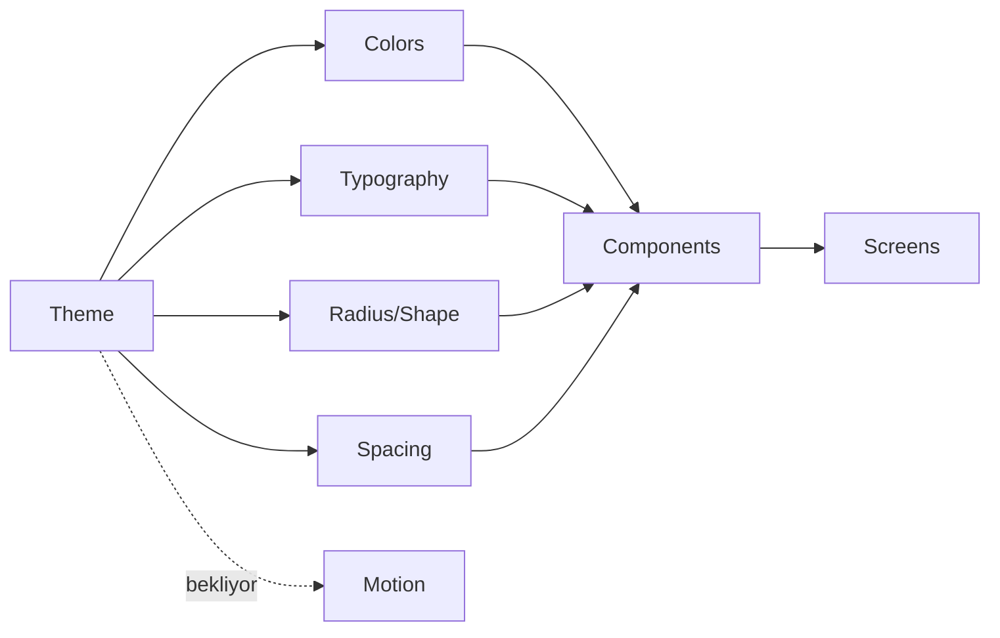

# Tasarım Sistemi Grafı

## Uygulanan temel

- `GymTrackerTheme`, sistem moduna bağlı light/dark Material 3 renk şeması kullanır; platform açılış penceresi de `values`/`values-night` ile aynı yüzeye geçer.
- `DesignTokens.kt`: ortak typography, spacing, shape ve minimum 48 dp touch/icon/content-width ölçülerini tanımlar.
- `GymTrackerComponents.kt`: ortak state/metric/action bileşenlerine ek olarak 840 dp sınırında liste-only veya 54/46 liste–detay düzeni seçen `GtListDetailScaffold` sağlar.
- Home referans ekran olarak bu bileşenlere taşındı; bottom navigation %200 fontta yalnız seçili etiketi göstererek çok satırlı taşmayı önler.
- Workout aktif/geçmiş liste ve detayları aynı token/state bileşenlerini tüketir; %200 fontta kart ve detay başlıkları dikey yerleşime geçer.
- Nutrition tarih/kalori/makro/öğün/edit-undo ve Measurements latest/gerçek chart/history/edit-undo yüzeyleri ortak tokenları tüketir; %200 fontta yatay metrikler dikeyleşir, chart dönemleri yatay kaydırılır.
- Progress Hub, Photos ve Muscle Load ortak tokenları; scroll/adaptive grid; açık empty/loading/error state’leri; renk bağımsız load listesi ve %200 font düzeni kullanır.
- Programs adaptive kart grid’i, ilişkisel gün accordion’ları, demo erişim/locked/empty/error state’leri ve plan→workout CTA’ları ortak token/resource/semantics sözleşmesini kullanır.
- Kullanıcıya görünen Home, Workout, Nutrition, Measurements, Progress Hub, Photos, Muscle Load, Programs ve alt navigasyon metinleri string resource’a taşındı.
- Varsayılan Türkçe ve İngilizce katalogları 356/356 anahtar eşitliğine sahiptir; kas adları ve para biçimi de aktif locale’e bağlıdır.
- Compact shell alt bar, 600 dp+ shell navigation rail kullanır; ikonlar yinelenen TalkBack açıklaması üretmez ve Progress Hub kartları birleşik button semantics sunar.
- Workout ve Programs 840 dp+ list–detail yüzeylerinde seçili kartı renk, 2 dp primary border ve `selected` semantics ile birlikte ifade eder; özet panelleri kaydırılabilir ve 48 dp ana eylem kullanır.

## Token ve tüketim grafı

Detaylı değerler: [[GELISTIRME_MASTER_PLANI#5. Görsel tasarım yönü]].

## Ortak bileşen durumu

- `current`: GtMetricCard, GtSectionHeader, GtQuickActionCard, GtEmptyState, GtLoadingState, GtErrorState, GtListDetailScaffold
- `current-core`: adaptive Home/Workout/Nutrition/Measurements/Progress/Programs content, font-aware bottom navigation ve 600 dp+ navigation rail
- `next`: ortak GtAdaptiveScaffold / GtTopAppBar; kalan uygun feature’larda list-detail değerlendirmesi
- `next`: GtPrimaryButton / GtTonalButton / GtProgressCard / skeleton
- GtNumberField / GtNumberStepper
- GtDateHeader
- GtExerciseRow / GtSetRow
- `partial`: Measurements chart card + Nutrition/Measurements SnackbarHost; ortak `GtChartCard/GtSnackbarHost` extraction bekler

## Kalite sözleşmesi ve kanıt

Her bileşen: normal/disabled/loading/error, light/dark, büyük font preview, 48dp touch, semantics, screenshot testi. Primary renk error yerine kullanılmaz; renk tek bilgi kanalı değildir. PR14 Progress Hub için iki baseline ekledi; PR17 English/light Programs ve Turkish/dark/%130 Workout geniş ekran baseline’larıyla kalıcı golden sayısını dörde çıkardı. Tüm ekranlara golden yayılımı ile disabled/loading varyantları henüz tamamlanmadı.

Görsel kanıtlar (build artifact): önceki PR görselleri; PR12 `pr12-nutrition-light.png`, `pr12-measurements-light.png`, `pr12-nutrition-dark-font200.png`, `pr12-measurements-dark-font200.png`, `pr12-measurements-chart-dark-font200.png`.

## Uygulama sırası

Home, active/read-only/planned Workout, Nutrition/Measurements, Progress/Photos/Load ve Programs çekirdek ekranları; uygulama geneli ikinci locale, adaptive shell ve Workout/Programs list-detail tamamlandı → sıradaki tasarım işi ortak top app bar/feedback bileşenleri ile kalan kritik state golden’larını genişletmektir. Ekran hedefleri: [[SCREEN_BLUEPRINT_GRAPH]].
