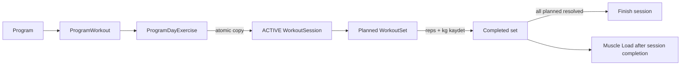

# Feature — Programlar

## Mevcut yetenek

- 2 ücretsiz + 3 kilitli demo program application-start transaction ile yalnız bir kez seed edilir.
- Liste ve ID tabanlı detail `Room Flow → repository → ViewModel UiState` yolunu kullanır; Activity recreation testi geçer.
- Room v7 `ProgramDayExercise` tablosu program günü egzersizlerini sıra, kararlı `exerciseId`, isim snapshot’ı, set/tekrar hedefi ve dinlenme süresiyle ilişkisel tutar.
- `MIGRATION_6_7`, v6 JSON içeriğini ilişkisel satırlara dönüştürür. Geçersiz JSON migration’ı çökertmez; kayıpsız inceleme için legacy payload `ProgramWorkout.exercises` alanında korunur ve UI boş/okunamayan plan state’i gösterir.
- Program günü tek transaction içinde aktif workout’a aktarılır. Başka aktif workout varsa yeni kopya üretmez ve mevcut seansı döndürür.
- Kopyalanan setler `isCompleted=false`, `reps=0`, `targetReps`, `exerciseId` ve reçete sırasını koruyan `exerciseOrder` ile planlanır. Kullanıcı gerçek tekrar/kiloyu kaydedene kadar Muscle Load’a girmez ve workout bitirilemez.
- Program list/detail; resource, token, adaptive grid/scroll, light/dark, %200 font, erişim/seviye metinleri ve açıklayıcı locked/empty/error state’leri kullanır.
- 840 dp altında program kartı mevcut `programs/{programId}` rotasını doğrudan açar. 840 dp+ genişlikte ortak `GtListDetailScaffold`, seçili kart ile özet panelini birlikte tutar; açık eylemi aynı kararlı ID rotasına geçer. `rememberSaveable` seçimi Activity state restoration boyunca korur.

## Veri ve yaşam döngüsü

Karar: [[ADR_007_RELATIONAL_PROGRAM_PLANS]]. Workout yaşam döngüsü: [[ADR_006_WORKOUT_SESSION_LIFECYCLE]].

## Güvenlik sözleşmeleri

- Kilitli demo program repository sınırında reddedilir; UI gizlemesine güvenilmez.
- Gün ID’si seçilen programa ait olmalıdır.
- Hedef set 1–20, tekrar boş olmayan, dinlenme 0–3600 saniye olmalıdır; bozuk legacy plan başlatılmaz.
- Program→workout copy ve active-session kontrolü tek Room transaction içindedir.
- Aktif seans varken program başlatma setleri çoğaltmaz.
- Planlanan set tamamlanmadan veya silinmeden workout finish başarısız olur.

## Kalan işler

- `ProgramWorkout.exercises` legacy fallback kolonu, destek penceresi ve gerçek fixture telemetrisi sonrasında ayrı migration ile kaldırılabilir.
- Fiyat `Float` ve `isPurchased` yalnız yerel demo durumudur; gerçek entitlement/billing değildir. Gerçek ödeme ayrı backend/billing ADR’ı gerektirir.
- Harici deep link ve gerçek OS process-death kabulü bekliyor; Activity saved-state restoration kapsamı geçiyor.
- Program ilerleme takvimi, tamamlanan gün işareti ve kullanıcıya özel programlar sonraki ürün dilimidir.

## Testler

- `DatabaseMigrationTest`: v3→v7 row preservation; v6 JSON→table; bozuk JSON kayıpsız fallback; yeni WorkoutSet kolonları.
- `ProgramSeedInitializerTest`: repeated/concurrent seed; 5 program, 23 gün, 108 ilişkisel egzersiz; legacy program koruma.
- `ProgramRepositoryTest`: atomic planned-set copy, existing-active resume, locked-program reject.
- `WorkoutRepositoryTest`: planlanan set tamamlanmadan finish reddi ve gerçek değerle completion.
- `ProgramsScreenTest`: %200 font liste, ilişkisel detail/start, locked demo state; 840 dp+ yerel seçim, state restoration ve kararlı-ID detay eylemi.
- `AdaptiveListDetailGoldenTest`: English/light 1000×700 program liste–özet baseline’ı.
- `NavigationSmokeTest`: ID route, back/bottom-bar policy ve Activity recreation.
