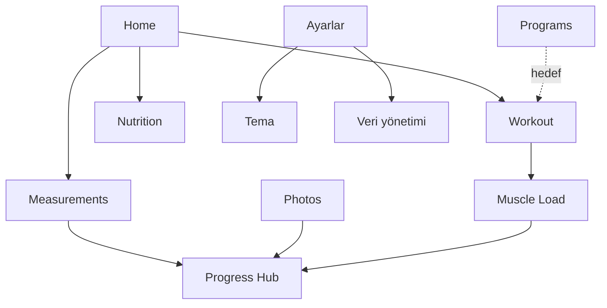

# MOC — Özellikler

| Özellik | Mevcut veri kaynağı | Ana risk | Düğüm |
|---|---|---|---|
| Özet | Workout + Measurement + Nutrition DAO | Eksik reaktif state | [[FEATURE_HOME]] |
| Antrenman | Workout DAO + ExerciseLibrary | Aktif/geçmiş karışıyor | [[FEATURE_WORKOUT]] |
| Beslenme | Nutrition DAO | Tarih/DST/validation | [[FEATURE_NUTRITION]] |
| Ölçümler | Measurement DAO | Validation ve trend yok | [[FEATURE_MEASUREMENTS]] |
| Fotoğraflar | ProgressPhoto DAO + content URI | URI kalıcı değil | [[FEATURE_PROGRESS_PHOTOS]] |
| Programlar | Program DAO + JSON serializer | Seed race ve detail bug | [[FEATURE_PROGRAMS]] |
| Kas yükü | Workout DAO + FatigueCalculator | Yaklaşık metrik/stale | [[FEATURE_MUSCLE_LOAD]] |
| Ayarlar ve veri | Preferences DataStore + veri yönetimi repository’leri | Etkisiz tercih/export kaybı | [[FEATURE_SETTINGS_DATA]] |

## Feature bağımlılıkları

Modern hedefte ölçüm, fotoğraf ve kas yükü tek “İlerleme” üst hedefinde gruplanır; ayrıntı [[ARCH_NAVIGATION]] içindedir.
