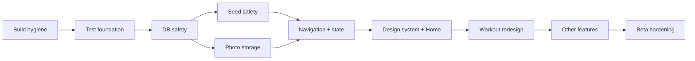

# MOC — Yol Haritası

- [[ROADMAP_EXECUTION_GRAPH]] — PR ve sprint bağımlılık grafı
- [[GELISTIRME_MASTER_PLANI#18. Fazlar ve süre tahmini]]
- [[GELISTIRME_MASTER_PLANI#19. Önerilen 2 haftalık sprint planı]]
- [[SESSION_HANDOFF]] — bugün başlanacak iş

## Ana sıra

Yeni oturum [[SESSION_START_PROTOCOL]] ile başlamalı ve tamamlanan PR sonrasında [[SESSION_HANDOFF]] güncellenmelidir.
