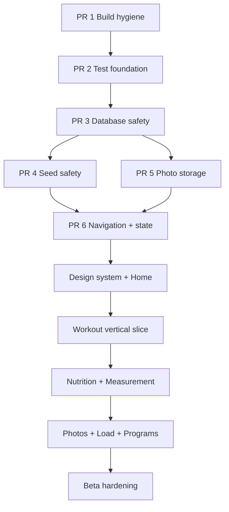

# Yol Haritası — Uygulama Grafı

## PR bağımlılıkları

## PR 1 — Build hygiene

Node: [[ARCH_BUILD_DI]].
Çıktı: wrapper, README/JDK17, ProGuard, permission/temp cleanup, lint error 0.
Kabul: temiz clone `test lint assembleDebug` komut zincirine hazır.

## PR 2 — Test foundation

Node: [[TEST_MATRIX]].
Çıktı: JUnit/coroutine/Room/Compose test altyapısı, CI, ilk Clock/validator/DAO testleri.
Kabul: test görevi artık NO-SOURCE değildir.

## PR 3 — Database safety

Node: [[ADR_003_EXPLICIT_ROOM_MIGRATIONS]].
Çıktı: schema export, migration sınıfları, destructive fallback kaldırma, fixture.
Kabul: desteklenen eski DB’lerden veri kayıpsız upgrade.

## PR 4 — Seed safety

Node: [[FEATURE_PROGRAMS]].
Çıktı: seedKey/contentVersion unique, transaction, ViewModel’den seed çıkarma.
Kabul: repeated/concurrent çağrıda tam 5 program; yarım yazma yok.

## PR 5 — Photo storage

Node: [[ADR_004_PERSISTENT_PHOTO_STORAGE]].
Durum: çekirdek kalıcılık tamamlandı.
Çıktı: picker import repository’si, app-owned file store, v5 metadata/migration, hata telafisi ve cleanup testleri.
Kabul: 9 cihaz testi geçiyor; EXIF/thumbnail, gerçek reboot ve backup politikası sonraki fotoğraf medya diliminde.

## PR 6 — Navigation + state skeleton

Node: [[ARCH_NAVIGATION]], [[ARCH_STATE_DATA_FLOW]], [[FEATURE_HOME]].
Durum: çekirdek iskelet tamamlandı.
Çıktı: 5 hedef shell, ID route, lifecycle state, reaktif Home dikey örneği.
Kabul: 8 JVM + 15 cihaz testi; detail/back/Activity recreation ve üç kaynaklı Home yenilemesi geçiyor. Harici deep link ve adaptive rail sonraki tasarım diliminde.

## PR 7 — Design system + Home

Node: [[DESIGN_SYSTEM_GRAPH]], [[FEATURE_HOME]].
Durum: temel ve Home referans uygulaması tamamlandı.
Çıktı: light/dark tema, type/spacing/shape/size tokenları, ortak metric/action/section/state bileşenleri, loading/content/error, midnight period tick, sahte sıfırsız empty state, font-aware compact/expanded Home.
Kabul: 11 JVM + 18 cihaz testi; lint 0 hata; light/dark/%200 font gerçek API 34 görsel kontrolü. Kalıcı golden altyapısı, navigation rail ve uygulama geneli bileşen dönüşümü sonraki dilimlerde.

## PR 8 — Workout lifecycle + modern kritik akış

Node: [[FEATURE_WORKOUT]], [[ADR_006_WORKOUT_SESSION_LIFECYCLE]], [[ARCH_DATABASE]].
Durum: uygulama ve kalite kapısı tamamlandı; PR8 yayın kapsamına alındı.
Çıktı: Room v6 status/completedAt migration, legacy completed politikası, tek aktif start/resume transaction’ı, status-korumalı mutation’lar, salt-okunur geçmiş, aktif Home CTA ve adaptive modern Workout ekranları.
Kabul: 11 JVM + 23 cihaz testi; lint 0 hata; v3→v6 migration; light/dark/%200 font gerçek API 34 kontrolü.

## PR 9 — Nutrition + Measurements doğruluk ve modernizasyon

Node: [[FEATURE_NUTRITION]], [[FEATURE_MEASUREMENTS]], [[ARCH_STATE_DATA_FLOW]].
Durum: uygulama ve kalite kapısı tamamlandı; `341bf79` commit’i stacked `codex/nutrition-measurements` dalında draft PR #2 olarak yayınlandı ve PR8 dalını hedefliyor.
Çıktı: DST-safe `LocalDate + Clock + ZoneId`, SavedStateHandle tarih seçimi, zero-goal/over-goal güvenliği, locale ondalık parser, ölçüm aralıkları/latest-history/trend ayrımı, adaptive modern ekranlar ve kaynak metinleri.
Kabul: 17 JVM + 27 cihaz testi geçti; lint 0 hata; light/dark/%200 font gerçek API 34 kontrolü tamamlandı.

## PR 10 — Progress Photos + Muscle Load modernizasyonu

Node: [[FEATURE_PROGRESS_PHOTOS]], [[FEATURE_MUSCLE_LOAD]], [[ADR_004_PERSISTENT_PHOTO_STORAGE]], [[ADR_005_MUSCLE_LOAD_NAMING]].
Durum: `2ad7ad8` commit’i `codex/progress-load` dalında stacked draft PR #3 olarak yayınlandı ve PR #2’yi hedefliyor.
Çıktı: device-local backup politikası, orphan/missing reconciliation, photo input validation/viewer/adaptive grid; completed-only reaktif load Flow, recency/bodyweight/unknown kuralları, metodoloji ve erişilebilir liste; modern Progress Hub.
Kabul: 20 JVM + 33 cihaz testi, lint 0 hata/67 uyarı, assemble ve light/dark/%200 API 34 görsel kontrolü.

## PR 11 — Programs normalizasyonu ve workout entegrasyonu

Node: [[FEATURE_PROGRAMS]], [[ADR_007_RELATIONAL_PROGRAM_PLANS]], [[ARCH_DATABASE]].
Durum: `7917358` commit’i `codex/programs-normalization` dalında stacked draft PR #4 olarak yayınlandı ve PR #3’ü hedefliyor.
Çıktı: Room v7 ilişkisel `ProgramDayExercise`, legacy JSON backfill/fallback, kararlı egzersiz ID, locked/ownership/target repository guard, atomic program→ACTIVE workout copy, planlanan-set completion/finish sözleşmesi ve modern adaptive Programs list/detail.
Kabul: 22 JVM + 41 cihaz testi; lint 0 hata/71 uyarı; assemble; light normal ve dark %200 Programs/detail/planned-workout API 34 görsel kontrolü.

## PR 12 — Nutrition/Measurements derinliği

Node: [[FEATURE_NUTRITION]], [[FEATURE_MEASUREMENTS]], [[ADR_008_SNAPSHOT_SAFE_EDIT_UNDO]], [[ARCH_DATABASE]].
Durum: `9c90471` commit’i `codex/nutrition-measurements-depth` dalında stacked draft PR #5 olarak yayınlandı ve PR #4’ü hedefliyor.
Çıktı: Room v8 measurement date index + period query/repository; 7/30/90/tümü gerçek kilo chart; özel tarih/edit/delete-undo; Nutrition snapshot-safe amount/meal edit + undo; scoped English resources, locale tarih, plural/birim ve dil-bağımsız testler.
Kabul: 24 JVM + 46 cihaz testi; lint 0 hata/77 uyarı; assemble; light normal ve dark %200 Nutrition/Measurements/chart API 34 görsel kontrolü.

## PR 13 — Photo media pipeline + personal load calibration

Node: [[FEATURE_PROGRESS_PHOTOS]], [[FEATURE_MUSCLE_LOAD]], [[ADR_004_PERSISTENT_PHOTO_STORAGE]], [[ADR_005_MUSCLE_LOAD_NAMING]].
Durum: `5c3ce35` kod commit’i `codex/photo-load-calibration` dalında yerel olarak tamamlandı; yayın bekliyor.
Çıktı: Room v9 photo thumbnail/dimension metadata; bounded decode, EXIF normalize, 2048 ana JPEG + 512 thumbnail ve iki dosyalı rollback/reconciliation; latest-valid measurement Flow’u ile kişisel bodyweight kalibrasyonu ve açık fallback UI.
Kabul: 26 JVM + 50 API 34 instrumentation testi; lint 0 hata/78 uyarı; assemble başarılı.

## Sonraki dikey dilimler

1. Uygulama geneli ikinci locale + adaptive navigation/accessibility/golden
2. Performance/release

Detaylı süre: [[GELISTIRME_MASTER_PLANI#18. Fazlar ve süre tahmini]]. Aktif durum: [[SESSION_HANDOFF]].
