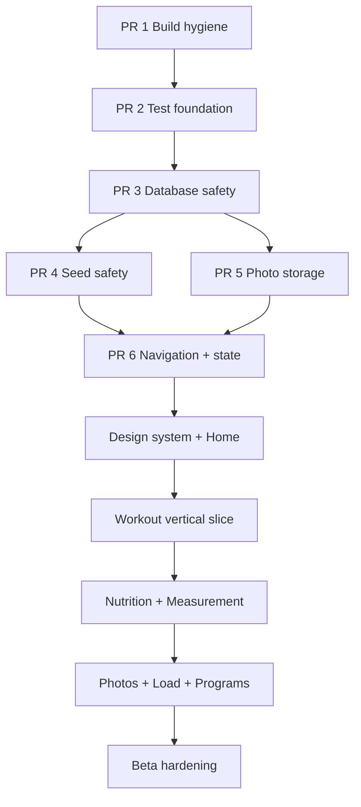

# Yol Haritası — Uygulama Grafı

## PR bağımlılıkları

## PR 1 — Build hygiene

Node: [[ARCH_BUILD_DI]].
Çıktı: wrapper, README/JDK17, ProGuard, permission/temp cleanup, lint error 0.
Kabul: temiz clone `test lint assembleDebug` komut zincirine hazır.

## PR 2 — Test foundation

Node: [[TEST_MATRIX]].
Çıktı: JUnit/coroutine/Room/Compose test altyapısı, CI, ilk Clock/validator/DAO testleri.
Kabul: test görevi artık NO-SOURCE değildir.

## PR 3 — Database safety

Node: [[ADR_003_EXPLICIT_ROOM_MIGRATIONS]].
Çıktı: schema export, migration sınıfları, destructive fallback kaldırma, fixture.
Kabul: desteklenen eski DB’lerden veri kayıpsız upgrade.

## PR 4 — Seed safety

Node: [[FEATURE_PROGRAMS]].
Çıktı: seedKey/contentVersion unique, transaction, ViewModel’den seed çıkarma.
Kabul: repeated/concurrent çağrıda tam 5 program; yarım yazma yok.

## PR 5 — Photo storage

Node: [[ADR_004_PERSISTENT_PHOTO_STORAGE]].
Durum: çekirdek kalıcılık tamamlandı.
Çıktı: picker import repository’si, app-owned file store, v5 metadata/migration, hata telafisi ve cleanup testleri.
Kabul: 9 cihaz testi geçiyor; EXIF/thumbnail, gerçek reboot ve backup politikası sonraki fotoğraf medya diliminde.

## PR 6 — Navigation + state skeleton

Node: [[ARCH_NAVIGATION]], [[ARCH_STATE_DATA_FLOW]], [[FEATURE_HOME]].
Durum: çekirdek iskelet tamamlandı.
Çıktı: 5 hedef shell, ID route, lifecycle state, reaktif Home dikey örneği.
Kabul: 8 JVM + 15 cihaz testi; detail/back/Activity recreation ve üç kaynaklı Home yenilemesi geçiyor. Harici deep link ve adaptive rail sonraki tasarım diliminde.

## PR 7 — Design system + Home

Node: [[DESIGN_SYSTEM_GRAPH]], [[FEATURE_HOME]].
Durum: temel ve Home referans uygulaması tamamlandı.
Çıktı: light/dark tema, type/spacing/shape/size tokenları, ortak metric/action/section/state bileşenleri, loading/content/error, midnight period tick, sahte sıfırsız empty state, font-aware compact/expanded Home.
Kabul: 11 JVM + 18 cihaz testi; lint 0 hata; light/dark/%200 font gerçek API 34 görsel kontrolü. Kalıcı golden altyapısı, navigation rail ve uygulama geneli bileşen dönüşümü sonraki dilimlerde.

## Sonraki dikey dilimler

1. [[FEATURE_WORKOUT]] status/active-session + modern kritik akış
2. [[FEATURE_NUTRITION]] + [[FEATURE_MEASUREMENTS]]
3. [[FEATURE_PROGRESS_PHOTOS]] + [[FEATURE_MUSCLE_LOAD]]
4. [[FEATURE_PROGRAMS]] normalizasyon/integration
5. Uygulama geneli adaptive navigation/accessibility/golden
6. Performance/release

Detaylı süre: [[GELISTIRME_MASTER_PLANI#18. Fazlar ve süre tahmini]]. Aktif durum: [[SESSION_HANDOFF]].
