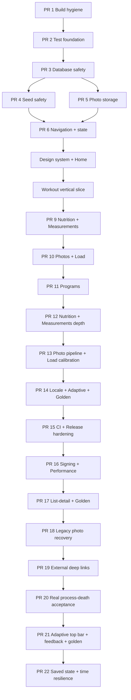

# Yol Haritası — Uygulama Grafı

## PR bağımlılıkları

## Birleştirme durumu

GitHub PR #1–#15 merge commit kullanılarak `master`a alındı; kaynak dallar silinmedi ve first-parent soy ağacı korundu. PR21/GitHub PR #15 hosted koşusu `29764819516` tamamen yeşildir; indirilen artifact XML 71 app + 2 ayrı process-death testini sıfır failure/error/skipped ile doğrular. PR21 merge commit `39927a7`; aktif PR22 code baseline `43b523a`, `codex/state-time-resilience` dalındadır.

## PR 1 — Build hygiene

Node: [[ARCH_BUILD_DI]].
Çıktı: wrapper, README/JDK17, ProGuard, permission/temp cleanup, lint error 0.
Kabul: temiz clone `test lint assembleDebug` komut zincirine hazır.

## PR 2 — Test foundation

Node: [[TEST_MATRIX]].
Çıktı: JUnit/coroutine/Room/Compose test altyapısı, CI, ilk Clock/validator/DAO testleri.
Kabul: test görevi artık NO-SOURCE değildir.

## PR 3 — Database safety

Node: [[ADR_003_EXPLICIT_ROOM_MIGRATIONS]].
Çıktı: schema export, migration sınıfları, destructive fallback kaldırma, fixture.
Kabul: desteklenen eski DB’lerden veri kayıpsız upgrade.

## PR 4 — Seed safety

Node: [[FEATURE_PROGRAMS]].
Çıktı: seedKey/contentVersion unique, transaction, ViewModel’den seed çıkarma.
Kabul: repeated/concurrent çağrıda tam 5 program; yarım yazma yok.

## PR 5 — Photo storage

Node: [[ADR_004_PERSISTENT_PHOTO_STORAGE]].
Durum: çekirdek kalıcılık tamamlandı.
Çıktı: picker import repository’si, app-owned file store, v5 metadata/migration, hata telafisi ve cleanup testleri.
Kabul: 9 cihaz testi geçiyor; EXIF/thumbnail, gerçek reboot ve backup politikası sonraki fotoğraf medya diliminde.

## PR 6 — Navigation + state skeleton

Node: [[ARCH_NAVIGATION]], [[ARCH_STATE_DATA_FLOW]], [[FEATURE_HOME]].
Durum: çekirdek iskelet tamamlandı.
Çıktı: 5 hedef shell, ID route, lifecycle state, reaktif Home dikey örneği.
Kabul: 8 JVM + 15 cihaz testi; detail/back/Activity recreation ve üç kaynaklı Home yenilemesi geçiyor. Harici deep link ve adaptive rail sonraki tasarım diliminde.

## PR 7 — Design system + Home

Node: [[DESIGN_SYSTEM_GRAPH]], [[FEATURE_HOME]].
Durum: temel ve Home referans uygulaması tamamlandı.
Çıktı: light/dark tema, type/spacing/shape/size tokenları, ortak metric/action/section/state bileşenleri, loading/content/error, midnight period tick, sahte sıfırsız empty state, font-aware compact/expanded Home.
Kabul: 11 JVM + 18 cihaz testi; lint 0 hata; light/dark/%200 font gerçek API 34 görsel kontrolü. Kalıcı golden altyapısı, navigation rail ve uygulama geneli bileşen dönüşümü sonraki dilimlerde.

## PR 8 — Workout lifecycle + modern kritik akış

Node: [[FEATURE_WORKOUT]], [[ADR_006_WORKOUT_SESSION_LIFECYCLE]], [[ARCH_DATABASE]].
Durum: uygulama ve kalite kapısı tamamlandı; PR8 yayın kapsamına alındı.
Çıktı: Room v6 status/completedAt migration, legacy completed politikası, tek aktif start/resume transaction’ı, status-korumalı mutation’lar, salt-okunur geçmiş, aktif Home CTA ve adaptive modern Workout ekranları.
Kabul: 11 JVM + 23 cihaz testi; lint 0 hata; v3→v6 migration; light/dark/%200 font gerçek API 34 kontrolü.

## PR 9 — Nutrition + Measurements doğruluk ve modernizasyon

Node: [[FEATURE_NUTRITION]], [[FEATURE_MEASUREMENTS]], [[ARCH_STATE_DATA_FLOW]].
Durum: uygulama ve kalite kapısı tamamlandı; `341bf79` commit’i stacked `codex/nutrition-measurements` dalında draft PR #2 olarak yayınlandı ve PR8 dalını hedefliyor.
Çıktı: DST-safe `LocalDate + Clock + ZoneId`, SavedStateHandle tarih seçimi, zero-goal/over-goal güvenliği, locale ondalık parser, ölçüm aralıkları/latest-history/trend ayrımı, adaptive modern ekranlar ve kaynak metinleri.
Kabul: 17 JVM + 27 cihaz testi geçti; lint 0 hata; light/dark/%200 font gerçek API 34 kontrolü tamamlandı.

## PR 10 — Progress Photos + Muscle Load modernizasyonu

Node: [[FEATURE_PROGRESS_PHOTOS]], [[FEATURE_MUSCLE_LOAD]], [[ADR_004_PERSISTENT_PHOTO_STORAGE]], [[ADR_005_MUSCLE_LOAD_NAMING]].
Durum: `2ad7ad8` commit’i `codex/progress-load` dalında stacked draft PR #3 olarak yayınlandı ve PR #2’yi hedefliyor.
Çıktı: device-local backup politikası, orphan/missing reconciliation, photo input validation/viewer/adaptive grid; completed-only reaktif load Flow, recency/bodyweight/unknown kuralları, metodoloji ve erişilebilir liste; modern Progress Hub.
Kabul: 20 JVM + 33 cihaz testi, lint 0 hata/67 uyarı, assemble ve light/dark/%200 API 34 görsel kontrolü.

## PR 11 — Programs normalizasyonu ve workout entegrasyonu

Node: [[FEATURE_PROGRAMS]], [[ADR_007_RELATIONAL_PROGRAM_PLANS]], [[ARCH_DATABASE]].
Durum: `7917358` commit’i `codex/programs-normalization` dalında stacked draft PR #4 olarak yayınlandı ve PR #3’ü hedefliyor.
Çıktı: Room v7 ilişkisel `ProgramDayExercise`, legacy JSON backfill/fallback, kararlı egzersiz ID, locked/ownership/target repository guard, atomic program→ACTIVE workout copy, planlanan-set completion/finish sözleşmesi ve modern adaptive Programs list/detail.
Kabul: 22 JVM + 41 cihaz testi; lint 0 hata/71 uyarı; assemble; light normal ve dark %200 Programs/detail/planned-workout API 34 görsel kontrolü.

## PR 12 — Nutrition/Measurements derinliği

Node: [[FEATURE_NUTRITION]], [[FEATURE_MEASUREMENTS]], [[ADR_008_SNAPSHOT_SAFE_EDIT_UNDO]], [[ARCH_DATABASE]].
Durum: `9c90471` commit’i `codex/nutrition-measurements-depth` dalında stacked draft PR #5 olarak yayınlandı ve PR #4’ü hedefliyor.
Çıktı: Room v8 measurement date index + period query/repository; 7/30/90/tümü gerçek kilo chart; özel tarih/edit/delete-undo; Nutrition snapshot-safe amount/meal edit + undo; scoped English resources, locale tarih, plural/birim ve dil-bağımsız testler.
Kabul: 24 JVM + 46 cihaz testi; lint 0 hata/77 uyarı; assemble; light normal ve dark %200 Nutrition/Measurements/chart API 34 görsel kontrolü.

## PR 13 — Photo media pipeline + personal load calibration

Node: [[FEATURE_PROGRESS_PHOTOS]], [[FEATURE_MUSCLE_LOAD]], [[ADR_004_PERSISTENT_PHOTO_STORAGE]], [[ADR_005_MUSCLE_LOAD_NAMING]].
Durum: `5c3ce35` kod + `d189f6c` graph commit’leri `codex/photo-load-calibration` dalında stacked draft PR #6 olarak yayınlandı ve PR #5’i hedefliyor.
Çıktı: Room v9 photo thumbnail/dimension metadata; bounded decode, EXIF normalize, 2048 ana JPEG + 512 thumbnail ve iki dosyalı rollback/reconciliation; latest-valid measurement Flow’u ile kişisel bodyweight kalibrasyonu ve açık fallback UI.
Kabul: 26 JVM + 50 API 34 instrumentation testi; lint 0 hata/78 uyarı; assemble başarılı.

## PR 14 — App-wide locale + adaptive navigation + golden baseline

Node: [[ARCH_NAVIGATION]], [[ADR_002_FIVE_TARGET_NAVIGATION]], [[DESIGN_SYSTEM_GRAPH]], [[TEST_MATRIX]].
Durum: `41c2ceb` kod + `f65e162` graph commit’leri `codex/adaptive-locale-goldens` dalında PR13’ü hedefleyen stacked draft PR #7 olarak yayınlandı: https://github.com/MehmetKucukOfficial/GymTracker/pull/7
Çıktı: 350/350 TR/EN kaynak eşitliği; locale-aware kas/para gösterimi; compact bottom bar + 600 dp+ rail; Progress Hub birleşik semantics; English light ve Turkish dark/%200 kalıcı golden baseline.
Kabul: 28 JVM + 54 API 34 instrumentation testi; lint ve assemble başarılı.

## PR 15 — CI + minified release hardening

Node: [[ARCH_BUILD_DI]], [[TEST_MATRIX]], [[RISK_REGISTER_GRAPH]].
Durum: `abd3fbe` kod commit’i `codex/ci-release-hardening` dalında PR14’ü hedefleyen stacked draft PR #8 olarak yayınlandı: https://github.com/MehmetKucukOfficial/GymTracker/pull/8
Çıktı: Linux-executable wrapper, tek `ciQuality`, PR/main quality job’u, API 34 device/golden job’u, 14 günlük rapor/release artifact’leri, R8 + resource shrinking ve APK/AAB/mapping üretimi.
Kabul: 28 JVM + 54 API 34 instrumentation testi; lint/debug; 2.56 MB minified APK, 4.81 MB AAB ve mapping başarılı. Hosted koşu `29459249716` quality 8 dk 51 sn ve API 34 device/golden 13 dk 13 sn ile tamamen yeşil.

## PR 16 — Secret-backed release + measured performance

Node: [[ARCH_BUILD_DI]], [[ADR_009_SECRET_BACKED_RELEASES]], [[PERFORMANCE_BASELINE]], [[TEST_MATRIX]].
Durum: `a2586d1` kod commit’i `codex/release-performance` dalında PR15’i hedefleyen stacked draft PR #9 olarak yayınlandı: https://github.com/MehmetKucukOfficial/GymTracker/pull/9
Çıktı: protected production workflow, fail-fast dört secret, runner-temp keystore, APK v2/v3 + AAB JAR signature doğrulaması; generated Baseline/Startup Profile; startup/Home scroll/Workout macrobenchmark.
Kabul: `ciQuality`, 54/54 API 34 regresyon; 2/2 profil üretici; 4 macrobenchmark senaryosu; dummy keystore ile signed releaseDistribution yeşil. Gerçek secret/Play smoke ve fiziksel-device performans kabulü operasyonel takip.

## PR 17 — Workout/Programs list-detail + golden expansion

Node: [[ARCH_NAVIGATION]], [[DESIGN_SYSTEM_GRAPH]], [[FEATURE_WORKOUT]], [[FEATURE_PROGRAMS]], [[TEST_MATRIX]].
Durum: `a573ab9` kod commit’i `codex/list-detail-goldens` dalında PR16’yı hedefleyen stacked draft PR #10 olarak yayınlandı: https://github.com/MehmetKucukOfficial/GymTracker/pull/10
Çıktı: ortak 840 dp `GtListDetailScaffold`; compact ID-route davranışını koruyan Workout/Programs expanded seçim + özet panelleri; saved selection; selected semantics; English/light Programs ve Turkish/dark/%130 Workout kalıcı golden’ları.
Kabul: 30 JVM + 58 API 34 instrumentation testi; `ciQuality`, lint, debug ve minified release/profile kapısı başarılı; 356/356 TR/EN kaynak eşitliği. Hosted run `29474876318` iki job ile tamamen yeşil, artifact XML 58/58.

## PR 18 — Legacy photo recovery + optimization

Node: [[FEATURE_PROGRESS_PHOTOS]], [[ADR_004_PERSISTENT_PHOTO_STORAGE]], [[TEST_MATRIX]].
Durum: `e28a22d` kod commit’i `codex/legacy-photo-recovery` dalında hazır GitHub PR #12 olarak yayınlandı: https://github.com/MehmetKucukOfficial/GymTracker/pull/12
Çıktı: v0 dış sağlayıcı kayıtları için yeniden seçim; v1 app-owned kayıtlar için doğrudan v2 optimizasyon; aynı Room kimliği ve kullanıcı metadata’sı; update başarısızlığında iki yeni dosyanın rollback’i; başarılı swap sonrasında eski yönetilen dosya temizliği; ayrı erişilebilir kart/viewer eylemleri.
Kabul: 30 JVM + 62 API 34 instrumentation testi; hedefli photo paketi 13/13; `ciQuality`, lint, debug ve minified release/profile kapısı; light normal ve dark %200 yükseltme UI doğrulaması. Hosted run `29503247012`: quality 7m23s, API 34 device/golden 9m41s, artifact XML 62/62.

## PR 19 — Validated external deep links

Node: [[ARCH_NAVIGATION]], [[ADR_002_FIVE_TARGET_NAVIGATION]], [[TEST_MATRIX]].
Durum: `a3bdbe6` kod + `f73987a` graph commit’leri GitHub PR #13 olarak hosted quality/API 34 kabulünden geçti ve merge commit `1d642ad` ile `master`a alındı; kaynak dal korundu.
Çıktı: `gymtracker://app` scheme/host manifest sözleşmesi; on NavHost destination pattern’i; merkezi URI üretme/parçalama; pozitif workout/program detail ID tipi; bilinmeyen/geçersiz URI safe-home fallback’i; cold-start ve recreation Compose testi.
Kabul: 34 JVM + 66 API 34 instrumentation testi; hedefli deep-link paketi 4/4; `ciQuality`, lint, debug ve minified release/profile kapısı başarılı.

## PR 20 — Real OS process-death acceptance

Node: [[ARCH_NAVIGATION]], [[ADR_002_FIVE_TARGET_NAVIGATION]], [[TEST_MATRIX]], [[PERFORMANCE_BASELINE]].
Durum: `8a2d350` tabanlı değişiklikler GitHub PR #14 olarak hosted kabulden geçti ve merge commit `625489a` ile `master`a alındı; otomatik master koşusu `29762392465` yeşil.
Çıktı: hedef uygulamadan ayrı process’te çalışan API 34 kabul paketi; Progress Photos alt rotası ve pozitif-ID Program detayı için dış URI cold start; Home’a alma; `am kill`; eski PID’nin kaybolması; aynı Android task kimliğiyle yeni PID ve doğru destination restorasyonu. GitHub device job’u iki test modülünün raporlarını artifact olarak saklar.
Kabul: 34 JVM + 66 app instrumentation + 2 ayrı gerçek process-death testi; `ciQuality`, lint, debug ve minified release/profile kapısı başarılı.

## PR 21 — Adaptive top app bar + feedback + critical goldens

Node: [[ARCH_NAVIGATION]], [[DESIGN_SYSTEM_GRAPH]], [[SCREEN_BLUEPRINT_GRAPH]], [[TEST_MATRIX]].
Durum: `e1359bb` kod + `bb1a061` graph commit’leri GitHub PR #15 olarak hosted kabulden geçti ve merge commit `39927a7` ile `master`a alındı; kaynak dal korundu.
Çıktı: `%200` fontta dinamik yüksekliğe sahip ortak `GtTopAppBar`; tek yerelleştirilmiş 48 dp geri eylemi; ortak `GtSnackbarHost`; Measurements/Photos/Load child rotaları ve Workout/Program detail loading/content/not-found durumlarında görünür geri sözleşmesi; Nutrition/Measurements/Photos/Programs feedback birliği; Turkish dark/%200 Nutrition over-goal ve English/light Measurements chart + top bar golden baselineları.
Kabul: 34 JVM + 71 API 34 app instrumentation + 2 ayrı gerçek process-death testi; hedefli feedback/navigation/golden paketi 11/11; `ciQuality`, lint, debug, minified APK/AAB, R8 mapping ve embedded profile başarılı.

## PR 22 — Saved state + Clock/ZoneId resilience

Node: [[ARCH_STATE_DATA_FLOW]], [[ARCH_NAVIGATION]], [[FEATURE_HOME]], [[FEATURE_NUTRITION]], [[FEATURE_MEASUREMENTS]], [[FEATURE_MUSCLE_LOAD]], [[TEST_MATRIX]].
Durum: code baseline `43b523a`, `codex/state-time-resilience` dalında; yerel tam kabul tamamlandı, graph/publish/hosted kabul sırada.
Çıktı: Home ve Kas Yükü için tek injectable `Clock`/dinamik `ZoneId` period Flow’u; yerel gece yarısı ve en geç 60 saniyede zone-change yeniden hesaplaması; bozuk Nutrition SavedState tarihinin güvenli Clock fallback’i; Nutrition seçili tarih ve Measurements 90-gün checked state’i için gerçek PID değişimli OS process-death restorasyonu.
Kabul: 37 JVM + 71 API 34 app instrumentation + 4 ayrı gerçek process-death testi; `ciQuality`, lint, debug, minified APK/AAB, R8 mapping ve embedded profile yerelde başarılı.

## Sonraki dikey dilim

1. PR22 graph/publish/hosted kabul ve merge
2. Progress Photos düşük alan/reboot/backup-restore ve büyük grid performans kabulü
3. Architecture/settings/export/beta hardening
4. Production secret + Play internal-track smoke, branch protection ve fiziksel cihaz performans kabulü

Detaylı süre: [[GELISTIRME_MASTER_PLANI#18. Fazlar ve süre tahmini]]. Aktif durum: [[SESSION_HANDOFF]].
